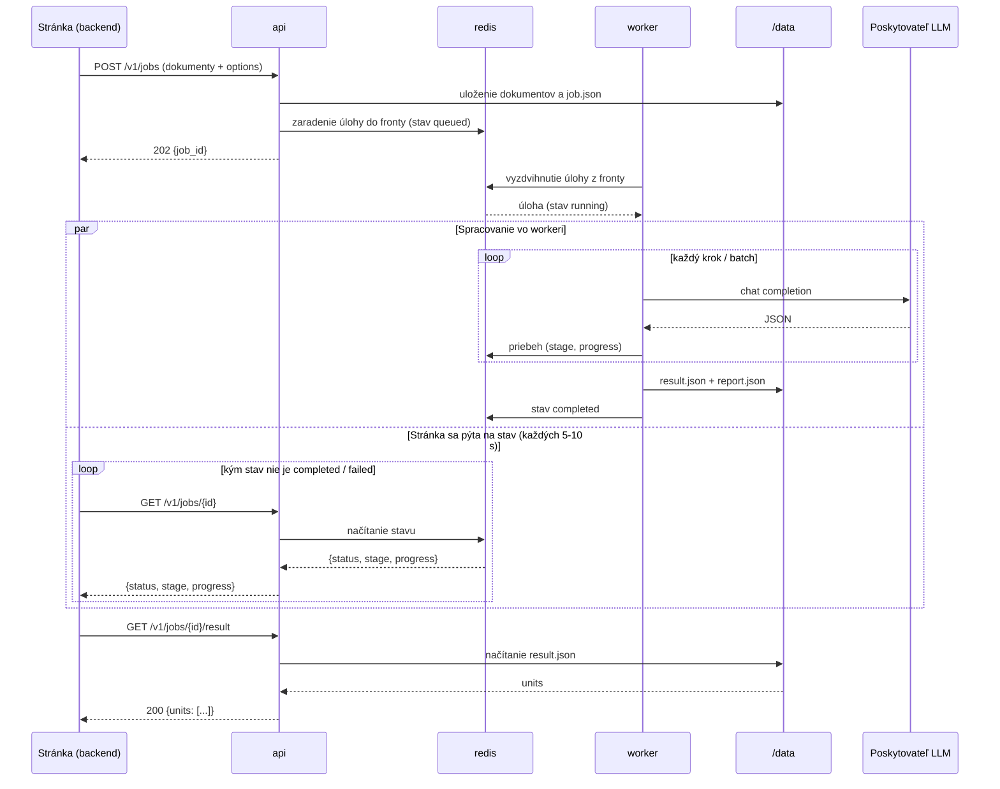
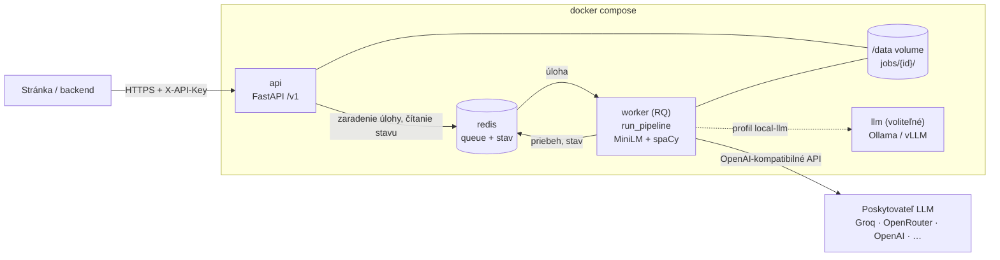
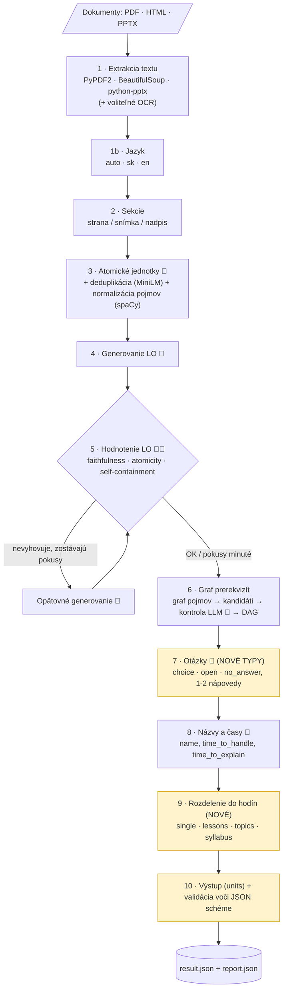

# Mlynček B - Martin Demčák

| **Osoba** | **Úloha** | **Task** |
| --- | --- | --- |
| @Martin Demčák | Zodpovedá za splnenie špecifikácie Mlynčeku B | [SCRUM-34](https://stuba-team-bxgehtkq.atlassian.net/browse/SCRUM-34) |

---

| **Product overview** | |
| --- | --- |
| **Target date** | 24.10.2026 |
| **Document status** | IN-PROGRESS |
| **Team members** | @Martin Demčák |
| **Quick links** | [Prílohy: technické podrobnosti](api-design-appendix.md) |
| **Work tracker** | [SCRUM-34](https://stuba-team-bxgehtkq.atlassian.net/browse/SCRUM-34) |
| **Repository** | <https://github.com/Matik080/LO-Generator/tree/integration> |

## Objective

Cieľom je navrhnúť, ako zo súčasného nástroja (Mlynček B, LO Generator, len obrovský wrapper, it's terrible) spraviť samostatnú službu v Docker kontajneri s REST API.

**Rovnaký API kontrakt ako Mlynček A.** Stránka, ktorá službu volá, pošle jeden alebo viac dokumentov a spôsob rozdelenia: buď "všetko do jednej hodiny", alebo podľa čoho sa má obsah rozdeliť (počet hodín, dĺžka hodiny, tematické celky, sylabus). Služba potom sama spustí všetky kroky:

- extrakciu textu,
- extrakciu atomických jednotiek,
- generovanie vzdelávacích objektov (LO),
- hodnotenie kvality a opätovné generovanie,
- graf prerekvizít,
- generovanie otázok (MCQ nesprávne varianty),
- rozdelenie do hodín.

**Rovnaký kontrakt a rovnaký výstup ako Mlynček A:** Mlynček B používa rovnaký kontrakt ako Mlynček A, teda rovnaké endpointy, rovnaký parameter `split` a rovnaký výstupný formát. Backend môže volať oba nástroje rovnako a prepínať medzi nimi.

**Výstup:** Výstupom je JSON vo formáte `units`. Každý unit je jedna vyučovacia hodina s názvom, popisom a otázkami daného typu: `choice`, `open` a `no_answer` (s nápovedami, možnosťami a časmi). Pri voľbe "všetko do jednej hodiny" má výstup práve jeden unit.

**Poskytovateľ modelu:** Služba nie je viazaná na jedného poskytovateľa LLM. Tool B už dnes volá modely cez OpenAI kompatibilné API (Groq, OpenRouter, GitHub Models, OpenAI). Rovnaké API by mohol poskytovať aj lokálny model. Potom by to bola len otázka konfigurácie.

**Nezávislosť od používateľa:** Spracovanie nezávisí od toho, či je používateľ na stránke. Používateľ môže stránku zavrieť a po návrate uvidí hotový výsledok. Služba výsledok uchová, stránka si ho prevezme kedykoľvek a žiadne upozornenia sa neposielajú.

## Success metrics

| **Goal** | **Metric** |
| --- | --- |
| Služba sa dá spustiť jedným príkazom. | `docker compose up` na čistom stroji (iba Docker + `.env`) spustí službu. `GET /health` vráti 200 do 60 s po štarte. |
| Stránke stačí jedno volanie. | Jeden `POST /v1/jobs` (dokumenty + spôsob rozdelenia) spustí všetky kroky. Stránka potom iba číta stav a výsledok (žiadny krok nespúšťa sama). |
| Spracovanie nezávisí od používateľa. | Úloha sa dokončí aj po zatvorení stránky alebo prerušení spojenia. Výsledok je dostupný cez `job_id` alebo `external_ref` počas celej doby uchovania (7 dní). Reštart kontajnerov nespôsobí stratu hotových výsledkov. Nedokončená úloha sa spustí znova. |
| Výstup má presne požadovaný formát. | 100% výstupov prejde validáciou voči JSON formátu `units`, teda bez polí navyše (automatické testy pre toto). |
| Otázky sú použiteľné. | Každá `choice` otázka má aspoň 2 možnosti a aspoň 1 správnu (správnych môže byť viac), bez duplicít. `open` má práve 1 vzorovú odpoveď. `no_answer` nemá možnosti. Nápovedy neprezrádzajú odpoveď (overí hodnotenie LLM). |
| Rozdelenie do hodín je korektné. | Súčet `time_to_handle + time_to_explain` v jednom unite (hodine) je v rozmedzí ±20% zadanej dĺžky hodiny. 0 porušení prerekvizít (Tool B už dnes vytvára graf prerekvizít). Žiadna prázdna hodina. |
| Kvalita sa nezhorší. | V referenčnom dokumente je priemerné skóre `Faithfulness` voči zdroju a podiel LO, ktoré prejdú filtrom kvality, aspoň taký ako dnes (východisková hodnota sa zmeria v M1 - Míľniku 1). |
| Model sa dá vymeniť konfiguráciou. | Zmena poskytovateľa LLM alebo embeddingov (cloud alebo lokálny server) je iba zmena premenných prostredia. |
| API odpovedá rýchlo. | Endpointy stavu a výsledku odpovedajú do 200 ms, dlhé spracovanie beží asynchrónne. |

## Assumptions

- Cieľový formát výstupu (`units.json`) je stanovený a musí sa dodržať presne, bez extra fields. Jeden unit = jedna vyučovacia hodina s názvom (`title`), popisom (`description`) a otázkami. Tool B už dnes vytvára LO v tomto formáte.
- `time_to_handle` (čas na vypracovanie študentom) a `time_to_explain` (čas na vysvetlenie) sú v sekundách a odhaduje ich LLM. Tool B to už dnes robí v `enrich_learning_objects`.
- Pole `hints[].url` obsahuje HTML text nápovedy (napr. `
…
`), nie webovú adresu.
- Vstupom sú dokumenty PDF, HTML a PPTX (jeden alebo viac). Tool B už dnes podporuje všetky tri. OCR zostáva voliteľný krok, o jeho predvolenom použití sa rozhodne neskôr.
- Generovanie ide cez OpenAI-kompatibilné API. Embeddingy predvolene počíta lokálny model MiniLM (malý, beží na CPU, bez nákladov na API). Voliteľne môžu ísť cez API poskytovateľa.
- Stránka si sama pamätá, ktoré úlohy patria ktorému používateľovi (cez `job_id` alebo vlastný `external_ref`). Služba používateľov nepozná a neposiela im upozornenia.
- Službu volá iba backend platformy cez internú sieť, nikdy priamo prehliadač používateľa. Overovanie používateľov a ich práv rieši backend platformy.

## Milestones

| **Miľník** | **Obsah** |
| --- | --- |
| M0 - Návrh | Tento dokument, schválenie návrhu, uzavretie otvorených otázok. Kontrakt zosúladený s Mlynčekom A. |
| M1 - Refaktor jadra htool | Oddelenie pipeline od HTML stránky a od globálneho stavu do funkcie `run_pipeline`; odstránenie globálnych logov a zdieľaných výstupných súborov, oprava nájdených chýb, meranie východiskovej kvality. |
| M2 - LLM vrstva a konfigurácia | Centrálna konfigurácia z prostredia, nastaviteľné adresy (base URL) a modely, rozhranie `Embedder` (lokálne / API). |
| M3 - API a úlohy | FastAPI `/v1`, `POST /v1/jobs`, queue úloh (Redis + RQ), stav a priebeh, chybové odpovede. |
| M4 - Nové otázky a formát units | Generovanie `choice` (viac správnych) / `open` / `no_answer`, nápovedy, časy, mapovanie do `units`, JSON schéma. |
| M5 - Rozdelenie do hodín | Režimy `single` / `lessons` / `topics` / `syllabus` alebo ako si to nastavíme, jedna hodina = jeden unit, validácia. |
| M6 - Docker a dokončenie | Dockerfile, docker-compose, README, example volania, testy. |

## Requirements

Označenia a znenie požiadaviek zodpovedajú stránke Mlynčeka A, takže sa obe stránky dajú porovnať 1:1. Stĺpec **"Tool B"** hovorí, koľko z toho už existuje v took B.

| **Requirement** | **User Story** | **Importance** | **Jira Issue** | **Tool B** | **Notes** |
| --- | --- | --- | --- | --- | --- |
| R1 Docker image | Ako správca chcem službu spustiť cez Docker, aby som nemusel inštalovať Python, Torch a ďalšie knižnice. | HIGH | | Čiastočne (Dockerfile existuje, modely sa sťahujú za behu) | Python 3.11-slim, torch CPU, modely zabalené v image. |
| R2 Jedno volanie spustí všetko | Ako stránka chcem poslať dokument a spôsob rozdelenia a nič viac. Všetky kroky nech služba spustí sama. | HIGH |  | Nie (HTML stránka volá kroky jeden po druhom) | `POST /v1/jobs`, FastAPI, prefix `/v1`. |
| R3 Asynchrónne úlohy | Ako stránka chcem sledovať stav, lebo spracovanie trvá rádovo minúty. | HIGH |  | Nie (synchrónne requesty) | 202 + `job_id`, stav, priebeh, zrušenie. |
| R4 Spracovanie bez prítomnosti používateľa | Ako používateľ chcem odísť zo stránky a po návrate vidieť hotový výsledok. | HIGH |  | Nie | Výsledok sa uchová v `/data`, stav úloh prežije reštart. |
| R5 Vlastný identifikátor stránky | Ako stránka chcem k úlohe pripojiť svoj identifikátor (napr. používateľa alebo kurzu) a podľa neho úlohy neskôr nájsť. | MEDIUM | - | Nie | `external_ref`, `GET /v1/jobs?external_ref=…` |
| R6 Výstup vo formáte units | Ako stránka chcem dostať JSON presne v dohodnutom formáte `units`. | HIGH |  | Čiastočne (`echub_format_converter`) | JSON schéma, validácia pred odoslaním. |
| R7 Hodina = unit | Ako učiteľ chcem, aby bol výstup rozdelený na vyučovacie hodiny, každá s názvom a popisom. | HIGH |  | Nie (súčasne 1 unit = 1 zdrojový dokument) | `units[]`: `title`, `description`, `questions`. |
| R8 Spôsob rozdelenia | Ako učiteľ chcem dať všetko do jednej hodiny alebo určiť, podľa čoho sa má obsah rozdeliť. | HIGH |  | Nie | `single`, `lessons`, `topics`, `syllabus` alebo podľa neskôr dohodnutého rozdelenia tímom |
| R9 Nové typy otázok | Ako učiteľ chcem otázky s možnosťami, otvorené otázky a úlohy bez vyhodnotenia, s nápovedami a časmi. | HIGH |  | Čiastočne (`choice` s 1 správnou odpoveďou, `open`, 1 nápoveda, časy) | `choice` (aj viac správnych), `open`, `no_answer` (nevyhodnocuje sa), 1 až 2 nápovedy, časy odhaduje LLM. |
| R10 Nezávislosť od poskytovateľa LLM | Ako správca chcem použiť model iného výrobcu alebo lokálny model bez zmeny kódu. | HIGH | | Čiastočne (OpenAI-kompatibilné API, ale pevné adresy a poskytovatelia) | OpenAI-kompatibilný adaptér pokrýva Groq, OpenRouter, OpenAI, Mistral, Gemini (OpenAI-kompatibilný endpoint), Ollama, vLLM; adaptér pre Anthropic iba v prípade potreby. |
| R11 Embeddingy cez API alebo lokálnym modelom | Ako správca chcem embeddingy počítať cez API zvoleného poskytovateľa alebo lokálnym modelom. | MEDIUM | - | Čiastočne (iba lokálny MiniLM) | Rozhranie `Embedder`: lokálny MiniLM (predvolený) alebo API, prahy podľa modelu. |
| R12 Konfigurácia cez prostredie | Ako správca chcem meniť modely, prahy a limity bez úpravy kódu. | MEDIUM | - | Čiastočne (`GEN_MODEL`, `INTER_CALL_DELAY`, `REASONING_EFFORT` v .env) | pydantic-settings, `.env.example` (premenovaný z `env_template`), prefix `LOGEN_`. |
| R13 Chyby a limity | Ako stránka chcem jasné chybové odpovede (zlý súbor, veľký súbor, chyba LLM). | MEDIUM | - | Čiastočne (iba nepodporovaný typ súboru) | Jednotný formát chyby. |
| R14 OpenAPI dokumentácia | Ako vývojár stránky chcem vidieť popis API a vyskúšať ho v prehliadači. | MEDIUM | - | Áno (FastAPI `/docs`) | `/docs` a `/openapi.json`. |
| R15 Voliteľné OCR | Ako správca chcem OCR zapnúť alebo vypnúť podľa typu dokumentov. | LOW | - | Nie | Parameter `extraction.ocr`, samostatný variant obrazu. |
| R16 Bezpečnosť | Ako správca chcem, aby službu mohol volať iba náš backend a aby jeden klient nemohol čítať ani mazať úlohy iného. | HIGH | [SCRUM-34](https://stuba-team-bxgehtkq.atlassian.net/browse/SCRUM-34) | Nie (žiadne overenie, kap. 1) | Povinný API kľúč, úlohy viazané na kľúč, UUID `job_id`, limity, sanitizácia HTML v nápovedách (kap. 12). |

## Out of Scope

- Samotná implementácia (SCRUM-34 je iba návrh a dokument).
- HTML stránka (`pipeline_ui.html`) ako klient služby. Môže zostať ako nástroj pre vývojárov nad starými endpointmi, ale nie je súčasťou kontraktu.
- Súčasné pomocné endpointy `/statistics`, `/add-sources`, `/save-los`. Pridanie zdrojov k hotovému výsledku = nová úloha.
- Preusporiadanie hotových výsledkov do iného počtu hodín bez nového spracovania. Nové rozdelenie = nová úloha.
- Správa používateľov a roly. Stačí jednoduchý API kľúč.
- Upozornenia používateľovi o dokončení (e-mail, notifikácie, webhook). Stránka si stav zistí sama.
- Trénovanie alebo dolaďovanie (fine-tuning) vlastného modelu.
- GPU akcelerácia, horizontálne škálovanie a Kubernetes.

## Design

### 1. Súčasný stav

Súčasne proces riadi HTML stránka `fastapi/pipeline_ui.html`, ktorá postupne volá `/extract-units` → `/generate-los` → `/evaluate` → `/build-graph` → `/export-echub` (v `fastapi/main.py`). Každý endpoint vráti výsledok prehliadaču a prehliadač ho pošle do ďalšieho kroku. Pri prerábaní treba vyriešiť tieto problémy:

| Problém v súčasnom kóde | Dôsledok | Riešenie v návrhu |
| --- | --- | --- |
| Kroky riadi prehliadač a drží aj stav (megabajty JSON medzi volaniami). | Pipeline sa nedá spustiť jedným volaním, ale na backende táto postupnosť existuje, len bude musieť byť prerobená, aby sedela na endpoints | Jedna funkcia `run_pipeline(params, progress_callback)`, všetko spustí worker. |
| Každý endpoint beží synchrónne niekoľko minút (zdieľaný `ThreadPoolExecutor(max_workers=2)`). | HTTP request vyprší, pri výpadku spojenia sa práca stratí. | Asynchrónne úlohy cez queue a worker. |
| Logy a priebeh sú globálne: `sys.stdout` je presmerovaný do jednej `_log_queue` a `_current_stage` je globálna premenná. | Súbežné úlohy si miešajú logy, priebeh za jednotlivú úlohu neexistuje. | `progress_callback` pre každú úlohu, uložený v Redise, logovanie po úlohách. |
| Výstupy sa zapisujú na pevné cesty `/app/output/*.json` (`_save`). | Súbežné úlohy by si prepisovali súbory. | Kroky vracajú dáta, zápis rieši vrstva úloh do `/data/jobs/{id}/`. |
| `filter_and_regenerate` (`ems.py`) číta `atomic_units.json` z disku. | Skrytá závislosť na disku (`/evaluate` to obchádza dočasným priečinkom). | Jednotky sa odovzdávajú v pamäti. |
| Grafy sa vracajú ako gpickle v base64. | Klienti mimo Pythonu ich neprečítajú, rozbaľovanie pickle nie je bezpečné. | Graf ako JSON (node-link) a iba v `/report`. |
| `llm_service.py` vyberá poskytovateľa pri importe, má pevné adresy (hodnoty `*_BASE_URL` v `env_template` sa ignorujú) a bez kľúča zavolá `exit(1)`. | Zmena poskytovateľa = zmena kódu, služba spadne namiesto toho, aby nahlásila chybu. | Konfigurácia z prostredia pri štarte (pydantic-settings), problém nahlási `/health` a `/v1/info`. |
| Výstup: `choice` má iba jednu správnu odpoveď (`mc_correct_index`), 1 nápovedu, chýba `no_answer`, 1 unit = 1 zdrojový dokument. | Nezodpovedá dohodnutému formátu `units` ani rozdeleniu do hodín. | Nové typy otázok, 1-2 nápovedy, krok `split` (kap. 8). |
| Dodatočné spracovanie LO (id, kľúčové slová, zdroj v nápovede) je skopírované 3× (`main.py` dvakrát, `ems.py`). | Opravy treba robiť na troch miestach. | Jedna spoločná pomocná funkcia.
| Žiadny endpoint nemá overenie prístupu. `/save-los` zapisoval súbor s menom z requestu (napr. `../main.py`), `/logs` posiela všetky logy komukoľvek, upload nemá limit veľkosti. | Ktokoľvek, kto sa dostane na port 8000, môže spúšťať úlohy na náš účet LLM, čítať logy a (do opravy) prepísať kód aplikácie. | Zápis cez `/save-los` je už opravený (povolené iba meno `*.json` bez ciest). Zvyšok rieši nové API (kap. 12). Do prerobenia sa súčasný kontajner nemá vystavovať mimo localhost. |

### 2. Typický scenár volania

Scenár je rovnaký ako pri Mlynčeku A. Stránka nepozná jednotlivé kroky spracovania, pošle jeden request a služba spraví zvyšok sama.

1. Stránka pošle `POST /v1/jobs` s dokumentmi a parametrom `split`, napr. "všetko do jednej hodiny" (`mode: single`) alebo "rozdeľ podľa tematických celkov na hodiny po 45 minút" (`mode: topics`).
2. Služba hneď odpovie `202 Accepted` a vráti `job_id`.
3. Worker sám spustí všetky kroky: extrakcia → jazyk → atomické jednotky → LO → hodnotenie LO a opätovné generovanie → graf prerekvizít → otázky → odhad časov → rozdelenie do hodín → zostavenie výsledného JSON.
4. Stránka si `job_id` uloží k používateľovi. Používateľ môže stránku zavrieť; spracovanie beží ďalej.
5. Keď je používateľ na stránke (hneď alebo po návrate), stránka sa pýta na stav (`GET /v1/jobs/{id}`). Ak `job_id` nemá, nájde úlohy podľa svojho identifikátora (`GET /v1/jobs?external_ref=…`).
6. Stránka stiahne výsledok (`GET /v1/jobs/{id}/result`): JSON presne vo formáte `units`, kde každý unit je jedna hodina. Údaje navyše (zdroje, skóre hodnotenia, graf) sú na `GET /v1/jobs/{id}/report`.

### 3. Architektúra

Služba sa skladá z troch kontajnerov, rovnako ako Mlynček A: API, worker a Redis. API prijíma requesty a vracia stav a výsledky. Dlhé spracovanie robí worker, ktorý si úlohy berie z fronty v Redise. LLM volá worker cez API zvoleného poskytovateľa. Ak sa nasadí lokálny model, beží ako ďalší voliteľný kontajner.

| Komponent | Technológia | Zodpovednosť |
| --- | --- | --- |
| api | FastAPI + Uvicorn, Pydantic v2 | Validácia vstupu, nahratie dokumentov, vytvorenie úlohy, stav, výsledky, OpenAPI dokumentácia, API kľúč |
| worker | RQ (Redis Queue), rovnaký obraz ako api | Spustí všetky kroky pipeline, hlási priebeh, uloží výsledný JSON a report do `/data`. Obsahuje lokálne modely MiniLM a spaCy. |
| redis | `redis:7-alpine` (appendonly) | Queue úloh, stav úlohy, priebeh (krok, progress). |
| /data (volume) | Docker volume | Nahraté dokumenty, výsledky a reporty, mazanie po TTL (7 dní alebo ako to budeme chcieť nastaviť). |
| llm (voliteľné) | Ollama alebo vLLM, GPU | Lokálny model s OpenAI-kompatibilným API. Zapne sa profilom `local-llm`. |

**Spracovanie bez prítomnosti používateľa**

- **Úloha nie je viazaná na spojenie.** Worker spracúva úlohu z queue a o stránke ani o prehliadači nevie. Zatvorenie stránky alebo výpadok spojenia spracovanie nezastaví.
- **Trvalé uloženie.** Každá úloha má priečinok `/data/jobs/{id}/`, v ktorom sú:
  - `job.json`: stav, parametre, `external_ref`, čas vytvorenia;
  - nahraté dokumenty;
  - `result.json` a `report.json`.

  Redis ukladá dáta na disk (appendonly), takže queue prežije reštart.
- **Reštart počas spracovania.** Ak worker spadne alebo sa reštartuje, nedokončená úloha sa vráti do queue a spustí sa znova od začiatku: max. 2 pokusy, potom `failed`. *Neskôr:* pokračovanie od posledného dokončeného kroku, keďže B už má mechanizmus checkpointov v `ems.process_book_with_checkpoints`. Hotové výsledky sa nestrácajú.
- **Doba uchovania.** Výsledky sú dostupné 7 (alebo koľko dohodneme) dní (`LOGEN_RESULT_TTL_DAYS`), potom ich služba zmaže.

### 4. Kroky spracovania

Prvé kroky zostávajú ako sú v súčasnej verzii (prompty a logika pochádzajú z bakalárskej práce). Mení sa generovanie otázok (nové typy) a pribudnú kroky `split` a `output`. LO, graf prerekvizít a hodnotenia zostávajú interné: slúžia na generovanie otázok a na určenie poradia a tém. Vo výstupnom formáte nie sú, nájdu sa iba v `/report`.

🤖 = volanie LLM (externý poskytovateľ). Všetko ostatné beží lokálne na CPU.

| # | Krok | Kód dnes | Zmena |
| --- | --- | --- | --- |
| 1 | Extrakcia textu | `utilities.extract_text_from_source` | voliteľné OCR pre strany bez textu |
| 1b | Jazyk | - | nové: `options.language` (`auto` = rozpoznanie `sk`/`en` z textu), pričom prompty dostanú jazyk výstupu. Normalizáciu pojmov v slovenčine treba overiť (spaCy je dnes iba anglický) |
| 2 | Sekcie | `utilities.split_into_sections` | bez zmeny |
| 3 | Atomické jednotky | `atomic_unit_extractor.extract_atomic_units_batch`, `clean_atomic_units`, `concept_normalizer.normalize_units` | nastaviť `source_title`/`source_page`, embeddingy cez `Embedder` |
| 4 | LO | `learning_object_generator.generate_learning_object_batch` | spoločná funkcia na dodatočné spracovanie |
| 5 | Hodnotenie LO | `ems.filter_and_regenerate`, `learning_object_evaluator.evaluate_learning_objects_batch` | jednotky v pamäti namiesto z disku |
| 6 | Graf | `graph_builder.build_concept_graph`, `build_layered_learning_paths`, `verify_prerequisites_batched`, `store_prerequisites` | bezpečnejšie odstraňovanie cyklov, JSON namiesto pickle |
| 7 | Otázky | `generate_mc_variants_batch` (choice s 1 správnou odpoveďou) | nové prompty pre `choice` s viacerými správnymi / `no_answer` (kap. 7) |
| 8 | Názvy a časy | `echub_format_converter.enrich_learning_objects` | orezanie časov na rozsah podľa typu |
| 9 | Rozdelenie do hodín | - | nový modul (kap. 8) |
| 10 | Výstup | `echub_format_converter.lo_to_question`, `convert_by_source` | mapovanie do hodín, validácia voči JSON schéme |

Každá funkcia pipeline dostane voliteľný parameter `progress_callback(stage, done, total)`. Cykly cez batche už vedia, pri ktorom batchi sú (dnes to iba vypisujú). Worker zapisuje priebeh do Redisu, takže stránka vidí napríklad "questions, 62%".

### 5. LLM vrstva - iní providers a lokálny model

Tool B volá modely na jednom mieste: `call_llm` v `llm_service.py`, cez SDK `openai`. Funkcia už obsahuje opakovanie pokusov, čakanie pri limite požiadaviek (`RateLimitError`) a smerovanie niektorých modelov cez OpenRouter (`LEGACY_ROUTES`, `OPENROUTER_MODELS`). To pokrýva väčšinu práce, chýba len konfigurovateľnosť.

| Adaptér | Pokrýva | Generovanie / embeddingy |
| --- | --- | --- |
| OpenAICompatibleAdapter (existuje už dnes, dostane nastaviteľnú `base_url`) | Groq, OpenRouter, OpenAI, Mistral, GitHub Models, Gemini (OpenAI-kompatibilný endpoint), lokálny server (Ollama, vLLM, LM Studio) | áno / áno (`/v1/chat/completions`, `/v1/embeddings`) |
| LocalEmbedder (existuje už dnes: `embedding_service.py`) | `all-MiniLM-L6-v2` na CPU vo workeri | - / áno (predvolený) |
| AnthropicAdapter (iba v prípade potreby) | Claude modely | áno / nie (embeddingy od iného poskytovateľa) |

**Zásady**

- **Výber cez konfiguráciu.** Poskytovateľ a model sa dajú nastaviť zvlášť pre generovanie, hodnotenie (`LOGEN_LLM_MODEL_EVAL`, dnes napevno v `main.py` a `ems.py`) a embeddingy.
- **Embeddingy.** Predvolene zostáva lokálny MiniLM: malý model (~90 MB), beží na CPU, nič nestojí a nepotrebuje sieť. Cez `LOGEN_EMBED_PROVIDER=openai_compatible` + `LOGEN_EMBED_BASE_URL` sa dajú počítať cez API poskytovateľa (R11) bez zmeny kódu.
- **Opakovanie a chyby** zostávajú v `call_llm`. Pribudne časový limit volania a namiesto `exit(1)` funkcia vyhodí zrozumiteľnú výnimku, ktorú úloha nahlási ako `llm_auth` / `llm_error`.
- **JSON výstup.** Adaptér zapne JSON režim, ak ho poskytovateľ má. `utilities.parse_json` (vrátane opráv escape sekvencií) a čiastočná obnova JSON v hodnotiacom module zostávajú.
- **Prahy podľa embedding modelu.** Prah deduplikácie (`similarity_threshold = 0.82` v `clean_atomic_units`) platí pre MiniLM. Pri inom modeli sa nakalibruje na referenčnom dokumente a uloží v konfigurácii.
- **Batche a kontextové okno.** Veľkosti batchov (dnes 3 sekcie pri extrakcii, 5 jednotiek pri generovaní, veľkosti podľa modelu v `MODEL_BATCH_SIZES` v hodnotiacom module) sa presunú do konfigurácie.
- **Jazyk.** Prompty a model spaCy sú dnes v angličtine. Slovenské zdroje treba overiť (otvorená otázka).

### 6. Výstupný formát (units)

Výstup je jeden JSON presne podľa dohodnutého formátu, rovnako ako pri Mlynčeku A. Pole `units` obsahuje vyučovacie hodiny, každá hodina má názov, popis a zoznam otázok. Do formátu nepridávame žiadne ďalšie polia. Údaje navyše sú v samostatnom endpointe `GET /v1/jobs/{id}/report`: zdroje a strany, typy LO, prerekvizity, skóre hodnotenia, graf a varovania.

| Pole | Význam | Ako ho vyplníme |
| --- | --- | --- |
| `units[]` | Vyučovacie hodiny | Výsledok rozdelenia (kap. 8). Pri `single` práve jeden unit. |
| `units[].title` | Názov hodiny | LLM podľa LO v hodine. V režime `topics` názov témy, v režime `syllabus` názov od učiteľa. |
| `units[].description` | Popis hodiny | 1-2 vety z LLM, v režime `syllabus` popis od učiteľa, ak ho poslal. |
| `questions[].name` | Krátky názov otázky | `generated_name` z `enrich_learning_objects` (5-8 slov). Dnes sa pridáva prefix `[Module X]` podľa zdroja, ten sa presunie do reportu, aby sa v rámci hodiny neopakoval. |
| `questions[].description` | Zadanie otázky alebo úlohy | Pole `question` z LO, pri `no_answer` zadanie úlohy. |
| `questions[].type` | `choice` \| `open` \| `no_answer` | Podľa typu otázky (kap. 7). |
| `questions[].time_to_handle` | Čas na vypracovanie (s) | Odhad LLM, orezaný na rozsah podľa typu. |
| `questions[].time_to_explain` | Čas na vysvetlenie (s) | Odhad LLM, orezaný na rozsah podľa typu. |
| `questions[].hints[]` | Nápovedy `{name, url}` | `name` = úroveň (napr. "Ľahká nápoveda"), `url` = HTML text nápovedy (`
…
`). |
| `questions[].choices[]` | Možnosti `{text, is_correct}` | `choice`: možnosti, správnych môže byť viac, `open`: 1 vzorová odpoveď, `no_answer`: prázdne. |

Celý príklad je v [Prílohách](api-design-appendix.md#výsledok-get-v1jobsidresult).

**Mapovanie zo súčasného výstupu B**

| Dnes (`learning_objects.json`, ECHub export) | Formát units |
| --- | --- |
| ECHub: 1 unit = 1 zdrojový dokument (`convert_by_source`) | `units[]` = hodiny z rozdelenia; `title`, `description` z LLM |
| `question` | `description` |
| `generated_name` (+ prefix `[Module X]`) | `name` (bez prefixu) |
| `mc_options` + `mc_correct_index` (práve 1 správna) | `type: choice`, `choices[{text, is_correct}]`, správnych môže byť viac |
| `answer` (LO bez `mc_options`) | `type: open`, `choices: [{text: answer, is_correct: true}]` |
| - (neexistuje) | `type: no_answer` (úloha bez vyhodnotenia) |
| `hint` (1 reťazec + `[Source: …]`) | `hints: [{name, url: "
…
"}]`, 1-2 úrovne. Zdroj sa presunie do reportu |
| `time_to_handle`, `time_to_explain` | rovnaké, fitnuté na rozsah |
| `id`, `type` (definition, rule…), `source_statement`, `source_title`, `source_page`, `keywords`, `anchor`, `prerequisite_ids`, `expected_output`, hodnotenia | nie sú vo formáte, dostupné v `/v1/jobs/{id}/report` |
| `concept_graph_b64`, `knowledge_graph_b64` (gpickle) | graf ako JSON v `/report` |

### 7. Generovanie nových typov otázok

Generovanie otázok (`learning_object_generator.py`) sa upraví tak, aby LLM rovno vracalo polia potrebné pre formát `units`. Vstup zostáva rovnaký: LO a jeho atomická jednotka (zdrojová pasaž). Pri `no_answer` aj susedné jednotky tej istej témy.

| Typ | Čo LLM vygeneruje | Kontrola |
| --- | --- | --- |
| `choice` | Zadanie, 3-5 možností z toho istého učiva, správnych môže byť jedna alebo viac, 1-2 nápovedy. Dnešné distraktory (`generate_mc_variants_batch`) sa rozšíria o viac správnych odpovedí. Iba pre typy LO, kde to dáva zmysel (dnes `MC_ELIGIBLE_TYPES`: definition, rule, property, fact, constraint, theorem). | Aspoň 2 možnosti a aspoň 1 správna, bez duplicít. Hodnotenie overí, že `is_correct` pri každej možnosti zodpovedá textu (rozšíri sa dnešné kritérium `distractor_plausibility`). |
| `open` | Zadanie, vzorová odpoveď (dnešné `answer` z LO, pri `algorithm_step`/`example` aj `expected_output` v odpovedi), 1-2 nápovedy. | Práve 1 položka v `choices` s `is_correct: true`. Faithfulness, Atomicity a Self-Contained ako dnes (`filter_and_regenerate`). |
| `no_answer` (nové) | Úloha, ktorá sa nevyhodnocuje. Téma vychádza zo skupiny LO/jednotiek s rovnakým pojmom `anchor`. Nápovedy sú voliteľné. | Prázdne `choices`. Zadanie je jasné a súvisí s učivom (nové kritérium hodnotenia). |

- **Nápovedy** majú úrovne (ľahká a ťažšia) a nesmú prezradiť odpoveď. Hodnotiaci modul ich už dnes hodnotí (`hint_quality`). LO so zavádzajúcou nápovedou sa vygenerujú znova.
- **Časy** odhadne LLM (`enrich_learning_objects`) podľa náročnosti otázky. Hodnota sa oreže na povolený rozsah podľa typu (tabuľka nižšie); ak chýba, použije sa predvolená.
- **Hodnotenie** (faithfulness, clarity, atomicity, self-containment, hint quality) zostáva a filtruje otázky ako dnes. Prahy (`faithfulness_threshold`, `hint_quality_threshold`, `max_attempts`) sa presunú do konfigurácie.

| Typ | time_to_handle (s) | time_to_explain (s) | Predvolené |
| --- | --- | --- | --- |
| `choice` | 30 - 180 | 0 - 90 | 120 / 30 |
| `open` | 120 - 900 | 0 - 180 | 300 / 0 |
| `no_answer` | 0 - 1800 | 0 - 600 | 300 / 0 |

Rozsahy sú rovnaké ako pri Mlynčeku A, takže oba nástroje dávajú porovnateľné hodiny.

### 8. Rozdelenie do hodín

Stránka v parametri `split` určí, či sa má všetko dať do jednej hodiny, alebo podľa čoho sa má obsah rozdeliť. Výsledkom je vždy jeden JSON s N položkami v `units` (N hodín), v režime `single` je N = 1. Režimy a parametre sú rovnaké ako pri Mlynčeku A. Algoritmus využíva to, čo tool B už má (graf prerekvizít, graf pojmov, zdrojové strany).

| Režim | Vstup | Výsledok |
| --- | --- | --- |
| `single` (predvolený) | - | Všetko do jednej hodiny - jeden unit. |
| `lessons` | `lesson_count` a/alebo `lesson_minutes` | Zadaný počet hodín s vyváženou dĺžkou, v poradí podľa prerekvizít. |
| `topics` | voliteľne `lesson_minutes` | Podľa tematických celkov dokumentu: hodina = jedna téma. Dlhá téma sa rozdelí na viac hodín, krátke susedné témy sa spoja. |
| `syllabus` | zoznam hodín: názov, voliteľne popis a rozsah strán | Hodiny podľa učiteľa. Otázky sa priradia k hodine podľa strán alebo podobnosti. |

**Algoritmus**

1. **Poradie.** LO sa zoradia topologicky podľa `prerequisite_ids` (graf z kroku 6 je už DAG). Pri zhode rozhoduje poradie zdrojov a strán (`source_title`, `source_page`). Ak by predsa zostal cyklus, preruší sa na hrane smerom k neskoršej strane a do reportu sa pridá varovanie.
2. **Čas.** Čas jedného LO = súčet `time_to_handle + time_to_explain` jeho otázok. Kapacita hodiny = `lesson_minutes × 60`.
3. **Témy.** Komunity v grafe pojmov (`build_concept_graph`, `louvain_communities` z networkx). Každé LO sa priradí ku komunite podľa svojho pojmu `anchor`. Pri dokumentoch s jasnými sekciami (snímky PPTX, nadpisy HTML) sa namiesto toho dajú použiť zdrojové sekcie.
4. **Rozdelenie.**
   - `lessons`: poradie LO sa rozdelí na N súvislých úsekov dynamickým programovaním tak, aby sa dĺžky čo najmenej líšili od kapacity. Hranica na rozhraní tém je preferovaná. Ak chýba `lesson_count`, N = ceil(celkový čas / kapacita).
   - `topics`: hodina = téma, dlhá téma sa rozdelí rovnakým spôsobom.
   - `syllabus`: priradenie podľa `source_page` a rozsahu strán hodiny, inak podľa podobnosti (MiniLM) medzi LO a názvom/popisom hodiny.
   - `single`: všetko do jednej hodiny.
5. **Poradie otázok v hodine.** Otázky idú v poradí LO. V rámci jedného LO najprv `choice`, potom `open` a nakoniec `no_answer`.
6. **Názov a popis hodiny.** Jedno volanie LLM na hodinu vytvorí `title` a `description` z názvov LO v hodine. V režime `topics` je základom názov témy, v režime `syllabus` sa použije názov a popis od učiteľa.
7. **Validácia.** Kontrola prerekvizít (žiadne LO nie je pred svojou prerekvizitou), prázdnych hodín a odchylky času od kapacity. Pri `single` a `syllabus` sa prekročenie času iba hlási vo `warnings` (v reporte).

### 9. Testovanie

- **Unit testy** pre modul rozdelenia (všetky režimy, cykly, prázdne vstupy, prekročenie času) a pre mapovanie do `units`.
- **Kontraktové testy:** každý výstup sa validuje voči JSON schéme formátu `units` (bez polí navyše). Schéma je spoločná s Mlynčekom A.
- **Integračné testy API** s falošným LLM (`call_llm` nahradený stubom, ktorý vracia pripravený JSON), bez volania skutočného LLM.
- **Regresný test kvality** na referenčnom dokumente: priemerné skóre faithfulness a podiel LO, ktoré prejdú filtrom, v porovnaní so súčasnou verziou (východisková hodnota z M1).
- **Test odolnosti:** klient sa po odoslaní odpojí, worker sa počas spracovania reštartuje. Výsledok musí byť po dokončení úlohy dostupný.
- **Smoke test Dockeru:** build, `docker compose up`, `/health`, jedna malá úloha end-to-end.

### 10. Postup zmien

1. Presunúť pipeline z `main.py` do balíka (napr. `lo_pipeline/`) bez zmeny logiky doménových modulov. Zlúčiť duplicitné dodatočné spracovanie LO. Opraviť nájdené chyby.
2. Nahradiť zápis do `/app/output` a globálne logy návratovými hodnotami a `progress_callback`. Pridať `config.py`.
3. Urobiť `llm_service.py` konfigurovateľným (base URL, modely, bez `exit`). Pridať rozhranie `Embedder`.
4. Upraviť generovanie otázok na `choice` (viac správnych) / `open` / `no_answer` s nápovedami a časmi. Pridať mapovanie do `units` a JSON schému.
5. Pridať modul rozdelenia do hodín.
6. Pridať `/v1` API, Redis + RQ a worker. Nakoniec Docker, testy a README.

Technické podrobnosti k implementácii (API, príklady requestov a odpovedí, chybové kódy, konfigurácia, Docker, štruktúra projektu) sú na samostatnej stránke [Prílohy](api-design-appendix.md). Ide o náčrt, ktorý sa pri implementácii môže zmeniť.

### 11. Odhad náročnosti

| # | Úloha | Mandays |
| --- | --- | --- |
| 1 | Refaktor pipeline: `run_pipeline` + `progress_callback`, spoločná funkcia na dodatočné spracovanie, jednotky v pamäti, opravy chýb, východisková kvalita | 2-2,5 |
| 2 | Konfigurácia (pydantic-settings), konfigurovateľný `llm_service`, rozhranie `Embedder` | 1-1,5 |
| 3 | Úlohy: Redis + RQ, worker, stav a priebeh v Redise, zrušenie, opätovné zaradenie po reštarte, `/data` + mazanie po TTL | 2,5-3 |
| 4 | `/v1` API: endpointy, Pydantic modely, formát chýb, API kľúč, `external_ref`, `/health`, `/v1/info`, `/v1/schema/lesson` | 1,5-2 |
| 5 | Nové typy otázok: `choice` s viacerými správnymi, `no_answer`, 1-2 nápovedy, `per_learning_object`, úpravy hodnotenia, jazyk výstupu (`options.language`) | 2,5-3,5 |
| 6 | Formát units: mapovanie, JSON schéma, validácia, `/report` (vrátane grafu v JSON) | 1-1,5 |
| 7 | Rozdelenie do hodín: 4 režimy, rozdelenie dynamickým programovaním, názvy hodín, validácia | 3-3,5 |
| 8 | Docker: viacstupňový image, modely v obraze, compose (api, worker, redis), healthcheck | 1 |
| 9 | Voliteľné OCR (variant obrazu + záložná extrakcia) | 1-1,5 |
| 10 | Testy (falošný LLM, kontrakt, rozdelenie, odolnosť, smoke), README, ukážkové volania | 2-2,5 |
| 11 | Bezpečnosť: povinný kľúč, úlohy viazané na kľúč, limity a rate limit, sanitizácia HTML, bezpečnostné testy | 1-1,5 |
| | **Spolu** | **≈ 19-23,5 človekodní** (približne 4-4,5 týždňa pre jedného človeka) |

**Riziká**

- **Limity a cena LLM:** bezplatná úroveň spomaľuje dlhé úlohy. Zmiernenie: `LOGEN_INTER_CALL_DELAY`, jeden worker, platená úroveň alebo lokálny model.
- **Čas spracovania:** veľké knihy môžu trvať aj hodinu a viac. Zmiernenie: pokračovanie z checkpointov (neskôr).
- **Kvalita rozdelenia:** heuristika, treba ju overiť na reálnych kurzoch. `topics` závisí od kvality grafu pojmov.
- **Nedeterministické výstupy:** ten istý vstup dáva iné otázky, preto testy používajú falošný LLM.
- **Dostupnosť modelov:** poskytovatelia modely vyraďujú (pozri `LEGACY_ROUTES` v `llm_service.py`), preto sa modely nastavujú v konfigurácii, nie napevno v kóde.

### 12. Bezpečnosť

Služba nemá používateľov ani osobné údaje, ale drží nahraté dokumenty, vygenerované otázky a kľúče k platenému LLM. Útočník, ktorý sa k nej dostane, by mohol čítať alebo mazať cudzie úlohy, minúť náš rozpočet na LLM alebo cez upravený dokument podstrčiť škodlivý obsah do testov. Preto platí:

| Riziko | Opatrenie |
| --- | --- |
| Služba bez overenia (prázdny `LOGEN_API_KEYS`). Potom by ktokoľvek mohol volať aj `DELETE /v1/jobs/{id}`. | API kľúč je **povinný**. Bez nastavených kľúčov služba nenaštartuje, výnimkou je iba lokálny vývoj (`LOGEN_DEV_MODE=true`). |
| Jeden klient číta, vypisuje alebo maže úlohy iného (napr. cez `GET /v1/jobs?external_ref=user-152`). | Každá úloha je viazaná na kľúč, ktorým bola vytvorená. Pre iný kľúč sa správa ako neexistujúca (404 `job_not_found`), takže sa nedá ani zistiť, či existuje. |
| Uhádnuteľné `job_id`. | `job_id` je UUID4 (122 náhodných bitov). |
| Zahltenie služby a minutie rozpočtu na LLM. | Limity veľkosti a počtu strán (`LOGEN_MAX_UPLOAD_MB`, `LOGEN_MAX_PAGES`), upload sa číta po častiach s kontrolou veľkosti, limit rozbalenej veľkosti PPTX (ZIP bomba), max. počet čakajúcich úloh na kľúč, inak `429 rate_limited`. |
| Škodlivý dokument (prompt injection) prinúti LLM vložiť do `hints[].url` napr. `<script>`. Ak ho platforma zobrazí bez úpravy, ide o stored XSS v teste. | Služba pred uložením prečistí HTML v `hints[].url` podľa zoznamu povolených značiek (`
`, `<b>`, `<i>`, `<code>`, `<pre>`, `<ul>`, `<ol>`, `<li>`, ` `). Ostatné polia sú čistý text. Platforma by mala HTML pri zobrazení aj tak escapovať alebo čistiť. |
| Prompt injection mení obsah otázok (napr. nesprávne označená správna odpoveď). | LLM nemá žiadne nástroje ani prístup k systému, takže riziko je iba v obsahu. Hodnotenie (faithfulness, kontrola `is_correct`) takéto otázky zväčša odfiltruje; otázky aj tak pred použitím kontroluje učiteľ. |
| Služba alebo Redis dostupné z internetu. | Port API sa publikuje iba do internej siete (alebo `127.0.0.1`), Redis nemá publikovaný port a má heslo (`requirepass`). `/docs` a `/openapi.json` sa v produkcii dajú vypnúť (`LOGEN_DOCS_ENABLED=false`). |
| Únik tajomstiev. | Kľúče iba v `.env` / Docker secrets, nikdy v obraze ani v logoch. Logy neobsahujú celé prompty ani obsah dokumentov. Kontajner beží pod používateľom bez root práv. |

**Poznámka k nálezom skenera.** Nájdené endpointy (`DELETE /api/helps/{id}`, `/api/options/{id}`, `/api/review/activity/{id}`, `/api/review/event/{id}`) patria backendu platformy, nie Mlynčeku A ani B. Odporúčanie pre backend: každý endpoint, ktorý mení dáta (POST/PUT/PATCH/DELETE), musí overiť prihláseného používateľa **aj** to, či má k danému objektu právo (napr. iba autor testu alebo učiteľ kurzu). Samotné prihlásenie nestačí.

## Open questions

| **Question** | **Answer** | **Date Answered** |
| --- | --- | --- |
| Aký má byť pomer typov otázok a koľko otázok na jedno LO alebo na hodinu? (spoločné s Mlynčekom A) | | |
| Zakomponovať OCR? Bez neho bude Docker obraz výrazne menší. (spoločné s Mlynčekom A) | | |
| Ktorý poskytovateľ LLM a embeddingov bude predvolený? Pre tool B: súčasne Groq/OpenRouter, embeddingy lokálny MiniLM. (spoločné s Mlynčekom A) | | |
| Kde bude služba nasadená a je potrebné overovanie API kľúčom? (spoločné s Mlynčekom A) | | |
| Ako dlho uchovávať nahraté dokumenty a výsledky (návrh: 7 dní)? (spoločné s Mlynčekom A) | | |
| Budú zdroje v slovenčine? Prompty a model spaCy v tool B sú dnes v angličtine. | | |
| Kto čistí HTML v `hints[].url`: služba (návrh, kap. 12), platforma pri zobrazení, alebo oboje? (spoločné s Mlynčekom A) | | |

## Reference Links

- Repozitár projektu: <https://github.com/Matik080/LO-Generator/tree/integration>
- Technické podrobnosti: [Prílohy](api-design-appendix.md)
- Stránka Mlynčeka A (vzor kontraktu): Mlynček A - Martin Štefanko
- FastAPI: <https://fastapi.tiangolo.com>
- Pydantic (JSON Schema): <https://docs.pydantic.dev/latest/concepts/json_schema/>
- pydantic-settings: <https://docs.pydantic.dev/latest/concepts/pydantic_settings/>
- RQ - Redis Queue: <https://python-rq.org>
- Docker Compose: <https://docs.docker.com/compose/>
- OpenAI API (chat, embeddingy): <https://platform.openai.com/docs/api-reference>
- Groq - kompatibilita s OpenAI: <https://console.groq.com/docs/openai>
- OpenRouter: <https://openrouter.ai/docs>
- Lokálny model s OpenAI API: Ollama <https://github.com/ollama/ollama>, vLLM <https://docs.vllm.ai>
- sentence-transformers (all-MiniLM-L6-v2): <https://www.sbert.net>
- NetworkX (DAG, komunity): <https://networkx.org>
- JSON Schema: <https://json-schema.org>