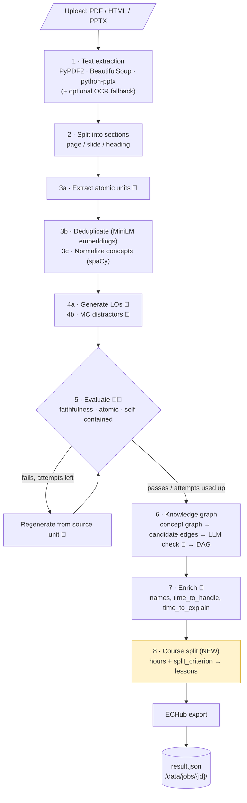
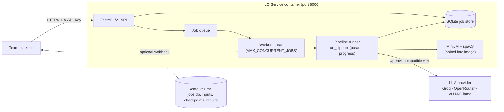
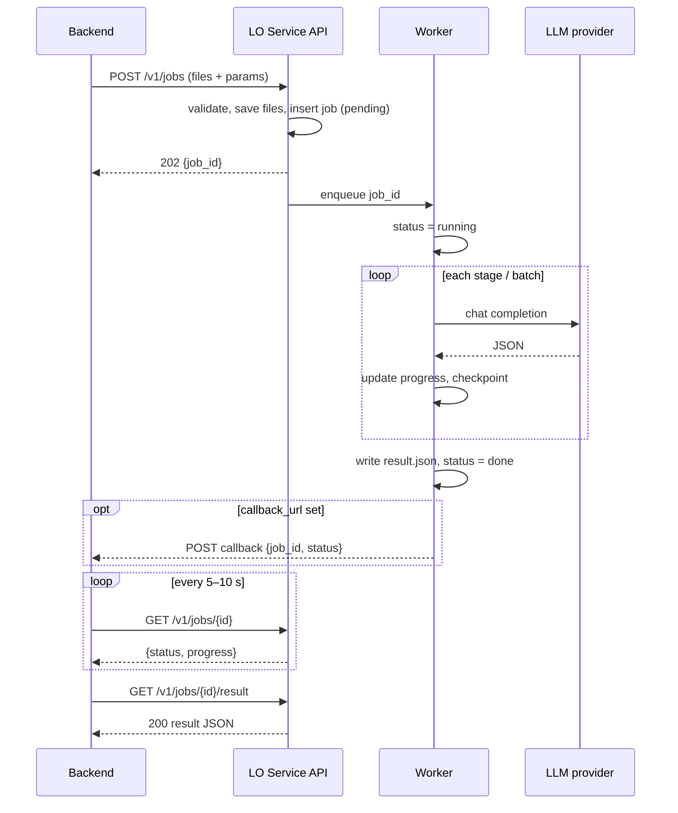

# LO Generator (mlynček B) as a Docker API service: design

| | |
|---|---|
| **Status** | Draft for review |
| **Scope** | Design only, no code changes yet |
| **Repo** | `LO-Generator` (`fastapi/`) |
| **Date** | 2026-10-23 |

---

## 1. Summary

The LO Generator (mlynček B) takes PDF/HTML/PPTX study material. It extracts atomic knowledge units, generates question/answer/hint learning objects (LOs) with multiple-choice options, filters them by quality, and builds a prerequisite graph. All of this is done with LLM calls.

The ticket assumes a Streamlit app. **The tool is already a FastAPI server** with a static HTML page (`fastapi/pipeline_ui.html`). The HTML page drives the pipeline step by step. So the API layer exists, but it can't serve a backend yet:

- every step is a **blocking HTTP request that runs for minutes**,
- the **browser holds the state** between steps,
- logs, progress and output files are **global**, shared by all users.

**Recommendation**

- One container with an **asynchronous job API**: `POST /v1/jobs` → `job_id` → poll status → fetch the result.
- One **background worker thread** inside the container, with job state in **SQLite** and files on a mounted `/data` volume.
- LLMs stay **external** (Groq/OpenRouter or any OpenAI-compatible server, set through env variables), so **no GPU is needed**.
- New feature: **course split**, where the backend sends `hours` and `split_criterion` and gets LOs grouped into lessons.

**Estimated effort:** about 12–16 person-days (see [section 8](#8-effort-estimate)).

---

## 2. Current state analysis

### 2.1 Pipeline steps

| # | Step | Code | LLM? | Input → Output |
|---|---|---|---|---|
| 1 | Text extraction | `utilities.extract_text_from_source` (PyPDF2 / BeautifulSoup / python-pptx) | no | file → text with `--- Page N \| Source: X ---` markers |
| 2 | Sectioning | `utilities.split_into_sections` | no | text → `[{page, source, content}]` (1 section = 1 PDF page / slide / HTML h1–h3 block) |
| 3a | Unit extraction | `atomic_unit_extractor.extract_atomic_units_batch` (batches of 3 sections) | yes | sections → raw units |
| 3b | Deduplication | `atomic_unit_extractor.clean_atomic_units` (MiniLM embeddings, `embedding_service.py`) | no (local model) | raw units → unique units |
| 3c | Concept normalization | `concept_normalizer.normalize_units` (spaCy lemmas) | no | adds `normalized_concepts` |
| 4a | LO generation | `learning_object_generator.generate_learning_object_batch` (batches of 5) | yes | units → LOs |
| 4b | MC variants | `learning_object_generator.generate_mc_variants_batch` | yes | adds `mc_options`, `mc_correct_index` |
| 5 | Quality filter | `ems.filter_and_regenerate` → `learning_object_evaluator.evaluate_learning_objects_batch` | yes (2+ models) | LOs → filtered LOs; failing ones regenerated up to `max_attempts` times |
| 6 | Knowledge graph | `graph_builder.build_concept_graph`, `assign_anchor`, `build_layered_learning_paths`, `verify_prerequisites_batched`, `store_prerequisites` | yes (edge check) | units + LOs → concept graph, prerequisite DAG, `prerequisite_ids` on each LO |
| 7 | ECHub export | `echub_format_converter.enrich_learning_objects` → `convert_by_source` / `convert_los_to_units` | yes (names, times) | LOs → ECHub `{units: [{title, description, questions}]}` |

Optional/analysis only: `post_statistics.analyze_evaluations`, `lexical_overlap_computation.lexical_overlap` (`/statistics` endpoint).

### 2.2 Data shapes (as produced today)

**Atomic unit**
```json
{
  "type": "definition",
  "statement": "malloc returns a pointer to the allocated memory block.",
  "concepts": ["malloc", "pointer"],
  "normalized_concepts": ["malloc", "pointer"],
  "source_title": "Module 1 - C Basics",
  "source_page": 12
}
```
`type` ∈ `definition | rule | property | algorithm_step | constraint | theorem | fact | example`.

**Learning object**
```json
{
  "id": "3f9a1c2b",
  "type": "definition",
  "question": "What does malloc return?",
  "answer": "A pointer to the start of the allocated memory block, or NULL on failure.",
  "hint": "Think about how you access the memory afterwards. [Source: Module 1 - C Basics, p. 12]",
  "source_statement": "malloc returns a pointer to the allocated memory block.",
  "source_title": "Module 1 - C Basics",
  "source_page": 12,
  "keywords": ["malloc", "pointer", "memory"],
  "mc_options": ["An int", "A pointer to the block", "The block size", "void"],
  "mc_correct_index": 1,
  "anchor": "malloc",
  "prerequisite_ids": ["a81c09de"]
}
```
`algorithm_step`/`example` LOs can also carry `expected_output`. After ECHub enrichment, an LO also gets `generated_name`, `time_to_handle` and `time_to_explain` (in seconds).

**Evaluation record** (one per LO per model): `lo_id`, `model`, `faithfulness` (1–5), `question_clarity` (1–5), `hint_quality` (1–5 / null), `self_contained` (yes/no), `atomic` (yes/no), `distractor_plausibility` (1–3 / null).

### 2.3 Current endpoints (`fastapi/main.py`)

| Method | Path | What it does |
|---|---|---|
| GET | `/` | serves `pipeline_ui.html` |
| GET | `/logs` | SSE stream of **all** stdout lines (global) |
| POST | `/extract-units` | one file → units (steps 1–3) |
| POST | `/generate-los` | `{units}` → LOs + MC (step 4) |
| POST | `/evaluate` | `{learning_objects, units, models, faithfulness_threshold, max_attempts}` → filtered LOs (step 5) |
| POST | `/build-graph` | `{units, learning_objects}` → LOs with prerequisites + graphs as **pickled base64** (step 6) |
| POST | `/statistics` | overlap + evaluation stats |
| POST | `/add-sources` | adds new units to an existing set, rebuilds the graph |
| POST | `/export-echub` | LOs → ECHub JSON (step 7) |
| POST | `/save-los` | writes LOs to `/app/output/` |

The HTML page calls these one by one and sends the whole JSON from one step into the next.

### 2.4 What blocks use from a backend

This is the real "UI coupling". There is no Streamlit to remove, but the browser acts as the orchestrator and the state store.

1. **Orchestration lives in the browser.** No endpoint runs the whole pipeline. The backend would have to reimplement the sequence the HTML page does and carry megabytes of JSON between calls.
2. **Synchronous long requests.** `/extract-units`, `/generate-los`, `/evaluate` and `/build-graph` each run for minutes. Proxies and HTTP clients time out, and a dropped connection loses the work.
3. **Global progress and logs.** `sys.stdout` is replaced by `_LogCapture`, which feeds one global `_log_queue`. `_current_stage` is a global variable. Two parallel runs mix their logs, and there is no per-run progress.
4. **Shared output files.** `_save()` writes to fixed paths like `/app/output/atomic_units.json`. Every run overwrites the previous one, so runs aren't isolated.
5. **Steps depend on disk.** `filter_and_regenerate` reads `atomic_units.json` from a directory (`/evaluate` works around this with a temp dir).
6. **Pickled graphs.** `concept_graph_b64` / `knowledge_graph_b64` are Python pickles. A non-Python backend can't read them, and unpickling untrusted data is unsafe. They should be node-link JSON.
7. **Config is fixed at import time.** `llm_service.py` picks the provider when it is imported, hard-codes the base URLs (the `*_BASE_URL` values in `env_template` are never read) and calls `exit(1)` when no key is set. `concept_normalizer.py` loads spaCy at import time.
8. **Duplicated logic.** The LO post-processing (id, keywords, source hint) is copy-pasted in three places: `main.py` `/generate-los`, `main.py` `/add-sources` and `ems.filter_and_regenerate`. The graph build is duplicated between `/build-graph` and `/add-sources`.
9. **Shared worker pool.** `ThreadPoolExecutor(max_workers=2)` has no queue limit and no cancellation.

### 2.5 Bugs found during the analysis (separate tickets)

| Bug | Effect |
|---|---|
| `beautifulsoup4` and `python-pptx` are missing from `requirements.txt` / `requirements.lock.txt` | HTML and PPTX uploads fail inside the Docker image |
| `/extract-units` never sets `source_title` / `source_page` on units (only `ems.process_book_with_checkpoints` does) | LOs from the web flow lose their source reference in hints and in ECHub grouping |
| The UI calls `POST /cancel` and `POST /cancel/clear`, which don't exist | the Cancel button does nothing |
| README says the MiniLM model is downloaded at build time, but the Dockerfile doesn't do it | first request downloads ~90 MB at runtime; fails without internet |
| DAG cycle removal deletes `cycle[-1]→cycle[0]` for every cycle from one `simple_cycles` list | can raise when two cycles share that edge, and doesn't guarantee a DAG |
| `requirements.lock.txt` is UTF-16 encoded | awkward for diffs and tooling; should be UTF-8 |

### 2.6 Keep vs. change

- **Keep as is:** the domain modules (`atomic_unit_extractor`, `learning_object_generator`, `learning_object_evaluator`, `graph_builder`, `echub_format_converter`, `embedding_service`, `utilities`). Their prompts and logic are the thesis work and stay untouched.
- **Change:** `main.py` gets split into an API layer, a job layer and a pipeline runner. `llm_service.py` gets env-based configuration. A new module adds the course split.

---

## 3. Target architecture

### 3.1 Pipeline


🤖 = LLM call (external provider). Everything else runs locally on CPU.

### 3.2 Components



### 3.3 Request flow



---

## 4. API

All new endpoints sit under `/v1`. Requests need the `X-API-Key: <SERVICE_API_KEY>` header (service-to-service auth), except `/health` and `/ready`. FastAPI generates the OpenAPI spec at `/docs` and `/openapi.json`, so the backend team can generate a client from it.

### 4.1 Endpoints

| Method | Path | Purpose | Success |
|---|---|---|---|
| POST | `/v1/jobs` | Create a job: files + parameters | `202` + `job_id` |
| GET | `/v1/jobs/{job_id}` | Status and progress | `200` |
| GET | `/v1/jobs/{job_id}/result` | Result JSON (`?format=full` default, `?format=echub` only the ECHub export) | `200`, or `409` if not finished |
| DELETE | `/v1/jobs/{job_id}` | Cancel a running/pending job; for a finished one, delete its data | `202` (cancel) / `204` (deleted) |
| GET | `/v1/jobs/{job_id}/events` | Optional SSE stream of this job's log lines and progress | `200 text/event-stream` |
| GET | `/v1/jobs` | Optional list (`?status=running&limit=20`) | `200` |
| GET | `/health` | Liveness: the process is up | `200 {"status":"ok"}` |
| GET | `/ready` | Readiness: LLM key configured, embedding model loaded, `/data` writable | `200` / `503` |

**Single steps ("only extraction", "only LOs", "only questions").** These go through the same `POST /v1/jobs` with a `stages` parameter, not through separate endpoints. Every step takes minutes, so every step needs the same async handling, status and errors anyway. One endpoint keeps that in one place. Examples:

- `"stages": ["extract"]` → returns only units.
- `"stages": ["generate", "evaluate"]` with `"input": {"units": [...]}` → starts from units the backend already has.
- `"stages": ["export"]` with `"input": {"learning_objects": [...]}` → re-export edited LOs.

Allowed stage names, in order: `extract`, `generate`, `evaluate`, `graph`, `enrich`, `course`, `export`. A request must pick a continuous range. The inputs a stage needs must come either from an earlier stage in the same job or from `input`. Default: all stages.

The old synchronous endpoints (`/extract-units`, …) stay for the HTML page during the transition. Later the page can move to `/v1` as well.

### 4.2 `POST /v1/jobs`

`multipart/form-data`:

- `files`: one or more files (`.pdf`, `.html`, `.htm`, `.pptx`), max `MAX_UPLOAD_MB` each
- `params`: JSON string (schema below)
- optional `titles`: JSON array of display titles, one per file (default: the file name). The title is used as `source_title`.

**`params`**

| Field | Type | Default | Meaning |
|---|---|---|---|
| `hours` | int ≥ 1 | `null` | Course length: how many lessons to split the LOs into. `null` = no course split |
| `split_criterion` | enum | `by_prerequisites` | How LOs are spread over lessons (see 4.3) |
| `gen_model` | string | env `GEN_MODEL` | Model for extraction, generation and the graph check (must be in `ALLOWED_MODELS`) |
| `eval_models` | string[] | env `EVAL_MODELS` | Models for the quality filter |
| `faithfulness_threshold` | float 1–5 | `3.0` | Minimum average faithfulness |
| `max_attempts` | int 1–5 | `2` | Evaluate/regenerate rounds |
| `mc` | bool | `true` | Generate multiple-choice options |
| `echub_mode` | `by_source` \| `single_unit` \| `by_lesson` | `by_lesson` if `hours` set, else `by_source` | ECHub grouping |
| `unit_title`, `unit_description` | string | — | For `single_unit` mode |
| `stages` | string[] | all | See 4.1 |
| `input` | object | — | `{units?, learning_objects?}` when starting mid-pipeline (JSON-only request: send `application/json` with no files) |
| `callback_url` | URL | — | Called with `{job_id, status}` when the job ends |

**Example**
```json
{
  "hours": 6,
  "split_criterion": "by_prerequisites",
  "gen_model": "openai/gpt-oss-120b",
  "eval_models": ["qwen/qwen3.8-27b", "openai/gpt-oss-120b"],
  "faithfulness_threshold": 3.0,
  "max_attempts": 2,
  "callback_url": "https://backend.example/api/lo-jobs/callback"
}
```

**Response `202 Accepted`** (plus a `Location: /v1/jobs/7d1e…` header)
```json
{
  "job_id": "7d1e4b2c-8f0a-4c51-9b7e-2a6f3e9d1c40",
  "status": "pending",
  "created_at": "2026-10-23T09:14:02Z",
  "links": {
    "self": "/v1/jobs/7d1e4b2c-8f0a-4c51-9b7e-2a6f3e9d1c40",
    "result": "/v1/jobs/7d1e4b2c-8f0a-4c51-9b7e-2a6f3e9d1c40/result"
  }
}
```

### 4.3 Course split (new feature)

`hours` = number of lessons N. Each lesson becomes one ECHub unit. `split_criterion` decides which LOs go together:

| Criterion | Rule | Good for |
|---|---|---|
| `by_prerequisites` *(default)* | Topologically sort the prerequisite DAG, then cut it into N consecutive chunks balanced by estimated time. A lesson never needs a later lesson | Courses where order matters |
| `by_topic` | Find communities in the concept graph (networkx `louvain_communities`), assign each LO by its `anchor`, then merge/split communities until there are N | Topic-based modules |
| `by_source` | Keep the document and page order and cut it into N parts balanced by time. If N equals the number of files, use 1 file = 1 lesson | Material that is already a lecture series |
| `even_time` | Ignore structure and balance the total `time_to_handle + time_to_explain` per lesson | Exam pools, revision sets |

The time-based criteria need the `enrich` stage (time estimates), so `course` always runs after `enrich`. Each lesson gets a title from the LLM, made from its LOs' names (one extra short call per lesson). The doc proposes no target minutes per hour. The service only reports `estimated_minutes` per lesson, and the backend decides whether a lesson is too full. *(Open question: should one hour also mean a time budget, so LOs get trimmed to fit? See section 9.)*

### 4.4 `GET /v1/jobs/{job_id}`

**Running**
```json
{
  "job_id": "7d1e4b2c-8f0a-4c51-9b7e-2a6f3e9d1c40",
  "status": "running",
  "created_at": "2026-10-23T09:14:02Z",
  "started_at": "2026-10-23T09:14:03Z",
  "finished_at": null,
  "progress": {
    "stage": "evaluate",
    "stage_index": 3,
    "stages_total": 7,
    "stage_done": 14,
    "stage_total": 40,
    "percent": 47,
    "message": "Evaluating batch 14/40 with openai/gpt-oss-120b"
  },
  "error": null
}
```

**Done:** `"status": "done"`, `"percent": 100`, `finished_at` set, plus `"summary": {"units": 112, "learning_objects": 98, "lessons": 6}`.

**Failed**
```json
{
  "job_id": "7d1e4b2c-8f0a-4c51-9b7e-2a6f3e9d1c40",
  "status": "failed",
  "finished_at": "2026-10-23T09:31:40Z",
  "progress": { "stage": "extract", "stage_index": 1, "stages_total": 7, "percent": 9 },
  "error": {
    "code": "LLM_RATE_LIMIT",
    "message": "Rate limit persisted after 6 attempts for model openai/gpt-oss-120b.",
    "stage": "extract"
  }
}
```

Statuses: `pending → running → done | failed | cancelled`. `percent` is a weighted estimate. Stages are weighted by how many LLM calls they usually make (extract ~20 %, generate ~25 %, evaluate ~30 %, graph ~15 %, the rest ~10 %).

### 4.5 `GET /v1/jobs/{job_id}/result`

```json
{
  "job_id": "7d1e4b2c-8f0a-4c51-9b7e-2a6f3e9d1c40",
  "schema_version": "1.0",
  "params": { "hours": 6, "split_criterion": "by_prerequisites" },
  "sources": [
    { "file": "module1.pdf", "title": "Module 1 - C Basics", "sections": 34, "units": 61 }
  ],
  "units": [
    { "type": "definition", "statement": "malloc returns a pointer to the allocated memory block.", "concepts": ["malloc", "pointer"], "normalized_concepts": ["malloc", "pointer"], "source_title": "Module 1 - C Basics", "source_page": 12 }
  ],
  "learning_objects": [
    { "id": "3f9a1c2b", "type": "definition", "question": "What does malloc return?", "answer": "A pointer to the allocated block, or NULL on failure.", "hint": "Think about how you access the memory afterwards.", "mc_options": ["An int", "A pointer to the block", "The block size", "void"], "mc_correct_index": 1, "source_title": "Module 1 - C Basics", "source_page": 12, "prerequisite_ids": ["a81c09de"], "generated_name": "Malloc Return Value and Pointer Use", "time_to_handle": 45, "time_to_explain": 30, "lesson_index": 2 }
  ],
  "knowledge_graph": {
    "nodes": [ { "id": "3f9a1c2b" }, { "id": "a81c09de" } ],
    "edges": [ { "source": "a81c09de", "target": "3f9a1c2b" } ],
    "is_dag": true
  },
  "concept_graph": {
    "nodes": [ { "id": "malloc", "centrality": 0.21 } ],
    "edges": [ { "source": "malloc", "target": "pointer", "weight": 4 } ]
  },
  "course": {
    "hours": 6,
    "split_criterion": "by_prerequisites",
    "lessons": [
      { "index": 1, "title": "Variables and Basic Types", "lo_ids": ["a81c09de"], "estimated_minutes": 38 },
      { "index": 2, "title": "Pointers and Dynamic Memory", "lo_ids": ["3f9a1c2b"], "estimated_minutes": 41 }
    ]
  },
  "echub": {
    "units": [
      { "title": "Pointers and Dynamic Memory", "description": "Lesson 2", "questions": [
        { "name": "[Module 1] Malloc Return Value and Pointer Use", "description": "What does malloc return?", "type": "choice", "time_to_handle": 45, "time_to_explain": 30,
          "hints": [ { "name": "Hint", "url": "<p>Think about how you access the memory afterwards</p>" }, { "name": "Source", "url": "<p>[Source: Module 1 - C Basics]</p>" } ],
          "choices": [ { "text": "An int", "is_correct": false }, { "text": "A pointer to the block", "is_correct": true }, { "text": "The block size", "is_correct": false }, { "text": "void", "is_correct": false } ] }
      ] }
    ]
  },
  "stats": {
    "total_units": 112,
    "total_los": 98,
    "type_distribution": { "definition": 31, "rule": 18, "example": 22, "fact": 27 },
    "regenerated_los": 9,
    "knowledge_graph_edges": 74,
    "llm_calls": 412,
    "duration_seconds": 1058
  }
}
```

Changes against today's output:

- graphs are node-link JSON (`networkx.node_link_data`) instead of pickles;
- the source note is no longer glued into `hint` (it is still in `source_title`/`source_page`, and ECHub still gets its "Source" hint);
- `schema_version` is new;
- the course split adds `lesson_index` on each LO.

`?format=echub` returns only the `echub` object, ready to upload.

### 4.6 Errors

Every error uses one shape:
```json
{
  "error": {
    "code": "UNSUPPORTED_FILE_TYPE",
    "message": "File 'notes.docx' is not supported. Allowed: .pdf, .html, .htm, .pptx",
    "details": { "file": "notes.docx" }
  }
}
```

**HTTP errors on requests**

| HTTP | `code` | When |
|---|---|---|
| 400 | `INVALID_PARAMS` | `params` is not valid JSON, the stage range has gaps, or required `input` is missing |
| 401 | `UNAUTHORIZED` | `X-API-Key` missing or wrong |
| 404 | `JOB_NOT_FOUND` | unknown or expired `job_id` |
| 409 | `JOB_NOT_FINISHED` | result requested while `pending`/`running` (`details.status` says which) |
| 409 | `JOB_FAILED` | result requested for a failed/cancelled job |
| 413 | `FILE_TOO_LARGE` | file over `MAX_UPLOAD_MB` |
| 415 | `UNSUPPORTED_FILE_TYPE` | extension not allowed |
| 422 | `VALIDATION_ERROR` | field out of range, model not in `ALLOWED_MODELS` (FastAPI validation, rewrapped into the envelope) |
| 429 | `QUEUE_FULL` | more than `MAX_QUEUED_JOBS` waiting; `Retry-After` header set |
| 500 | `INTERNAL_ERROR` | unexpected exception |
| 503 | `NOT_READY` | `/ready` failed: no LLM key, model not loaded, disk full |

**Job failure codes** (in `error.code` of a failed job)

| `code` | Meaning |
|---|---|
| `NO_TEXT_EXTRACTED` | no text in any file (e.g. a scanned PDF without OCR) |
| `LLM_RATE_LIMIT` | the provider kept rate-limiting after all retries in `call_llm` |
| `LLM_ERROR` | the provider failed or returned unusable output after retries |
| `LLM_AUTH` | API key rejected |
| `NO_UNITS` | extraction produced zero units |
| `INTERRUPTED` | the container restarted while the job was running |
| `CANCELLED` | cancelled via `DELETE` (status `cancelled`) |
| `INTERNAL_ERROR` | any other exception; the message has the exception text, the job log has the traceback |

---

## 5. Asynchronous processing

### 5.1 Recommended: in-process worker + SQLite

- On startup, the FastAPI app starts **one worker thread** (or `MAX_CONCURRENT_JOBS` threads) that reads job ids from a queue.
- The default is **1 concurrent job**. The pipeline is bound by LLM rate limits, not CPU, so two jobs on the same Groq key would only slow each other down.
- **Job store:** SQLite at `/data/jobs.db`, table `jobs(id, status, params_json, progress_json, error_json, created_at, started_at, finished_at)`. SQLite is in the standard library, survives restarts, and is enough for one container.
- **Files per job:** `/data/jobs/{job_id}/`
  - `input/`: uploaded files
  - `checkpoints/`: `units.json`, `los.json`, `los_evaluated.json`, … written after each stage
  - `result.json`: the final output (written to a temp file, then renamed, so a reader never sees half a file)
  - `job.log`: this job's log lines
- **Progress:** `run_pipeline(params, progress)` passes a `progress(stage, done, total, message)` callback into the batch loops. The loops already know their batch index, since they print it today. The global stdout capture goes away. Logging uses `logging` with a per-job handler.
- **Cancel:** `DELETE` sets a `cancel_requested` flag. The `progress` callback checks it after each batch and raises `JobCancelled`. Work stops at the next batch boundary.
- **Restart:** on startup, jobs still marked `running` become `failed` with `INTERRUPTED`. *Later:* resume them from the last stage checkpoint, the same way `ems.process_book_with_checkpoints` already does it.
- **Cleanup:** a periodic task deletes jobs and their folders older than `JOB_TTL_DAYS`.
- **Webhook (optional):** when a job ends, POST `{job_id, status}` to `callback_url` with 3 retries. Polling still works without it.

### 5.2 Why not Celery/Redis now

A separate broker and worker container only pays off with several workers or replicas. The bottleneck is the external LLM rate limit, so more workers don't make jobs faster. If it is needed later, the job layer can be swapped for **Redis + RQ** without touching the API or the pipeline runner, because both only talk to a `JobStore`/`enqueue()` interface.

### 5.3 Expected duration

The LLM call count grows with document size. For one ~30-page lecture (≈ 30 sections → ~80–120 units):

- extraction ≈ 10 calls,
- generation + MC ≈ 40–50,
- evaluation ≈ (units / batch size) × models × attempts ≈ 60–100,
- graph check ≈ (candidate edges / 10),
- enrichment ≈ 10.

That is **a few hundred calls → roughly 5–20 minutes**, depending on the provider and `INTER_CALL_DELAY`. Rate-limit backoff in `call_llm` waits 60 s or more, so runs can take longer. Polling every 5–10 s is enough, or the backend can use the webhook.

---

## 6. Configuration (environment variables)

| Variable | Default | Purpose |
|---|---|---|
| `LLM_BASE_URL` | — | Base URL of the primary OpenAI-compatible provider (Groq, OpenRouter, vLLM, Ollama…) |
| `LLM_API_KEY` | — | Key for the primary provider |
| `GROQ_API_KEY`, `OPENROUTER_API_KEY`, `GITHUB_TOKEN`, `OPENAI_API_KEY` | — | **Backward compatible.** Used as today when `LLM_BASE_URL` is not set (priority Groq > OpenRouter > GitHub > OpenAI) |
| `GROQ_BASE_URL`, `OPENROUTER_BASE_URL`, `GITHUB_BASE_URL` | current hard-coded URLs | Actually read now (today they're in `env_template` but ignored) |
| `GEN_MODEL` | provider default | Default generation model (exists today) |
| `EVAL_MODELS` | `qwen/qwen3.8-27b,openai/gpt-oss-120b` | Default evaluator models (comma-separated); today hard-coded in `main.py`/`ems.py` |
| `ALLOWED_MODELS` | `GEN_MODEL` + `EVAL_MODELS` | Models a request may choose; others → 422 |
| `REASONING_EFFORT` | — | GPT-OSS reasoning effort (exists today) |
| `INTER_CALL_DELAY` | `0.1` | Pause between LLM calls (exists today) |
| `SERVICE_API_KEY` | — (required) | Key the backend sends in `X-API-Key` |
| `DATA_DIR` | `/data` | Job store, inputs, results |
| `MAX_CONCURRENT_JOBS` | `1` | Worker threads |
| `MAX_QUEUED_JOBS` | `20` | Above this → 429 |
| `MAX_UPLOAD_MB` | `50` | Per-file limit |
| `JOB_TTL_DAYS` | `14` | Cleanup age |
| `CORS_ORIGINS` | empty | Only needed if a browser calls the service directly |
| `LOG_LEVEL` | `INFO` | Logging |
| `SPACY_MODEL` | `en_core_web_sm` | Exists today |
| `OCR_ENABLED` | `false` | Use the OCR fallback (only in the `ocr` image) |

Rules:

- Secrets come only from env or Docker secrets, never from the image. `.dockerignore` already excludes `.env`.
- `llm_service.py` reads the config when the app starts instead of at import time. It raises a clear error and does not call `exit(1)`, so `/ready` can report the problem.

---

## 7. Docker

### 7.1 Image

| Topic | Today | Proposal |
|---|---|---|
| Base | `python:3.11-slim` | same |
| Build tools | `gcc g++` stay in the final image | **multi-stage**: compile wheels in a builder stage, copy only site-packages |
| torch | CPU wheel (`--index-url …/cpu`) | same; no CUDA |
| Models | spaCy + NLTK at build time; MiniLM **downloaded at runtime** | bake **all three** at build time (`SentenceTransformer("all-MiniLM-L6-v2")` in a `RUN` step), so it works offline |
| Missing deps | `beautifulsoup4`, `python-pptx` | add to `requirements.txt` and the lock file |
| Unneeded deps | `matplotlib`, `seaborn`, `pandas` (only offline analysis/plots) | move to `requirements-dev.txt`; change the module-level `import matplotlib` in `graph_builder.py` into a local import in `visualize_graph` |
| User | root | non-root `app` user |
| Health | none | `HEALTHCHECK CMD curl -f http://localhost:8000/health` |
| Port | 8000 | 8000 |
| Volumes | `./fastapi/input`, `./fastapi/output` | one `/data` volume |
| Process | `uvicorn main:app` | `uvicorn app.main:app --workers 1`. Must be **1 process**, because the job queue lives in memory; more processes would need RQ |

### 7.2 GPU

**Not needed.** The only local model is MiniLM-L6 (22M parameters) for embedding-based dedup, which takes seconds on CPU. All big models run at the external provider. If the team later hosts its own model (vLLM/Ollama), that runs as a **separate** container or server, and this service just points `LLM_BASE_URL` at it.

### 7.3 OCR

There is no OCR today. `PyPDF2.extract_text()` returns nothing for scanned PDFs, and such pages are skipped. Proposal:

- an optional build target `ocr`, adding `tesseract-ocr` (+ language packs `eng`, `slk`), `poppler-utils`, `pytesseract`, `pdf2image`: about +100–150 MB;
- with `OCR_ENABLED=true`, pages where PyPDF2 finds less than ~30 characters get rendered and OCR'd;
- the normal image stays smaller. The team picks the target in compose.

### 7.4 Size

Expected **≈ 1.5–2.5 GB** uncompressed. Most of it is torch CPU (~700 MB installed), transformers and sentence-transformers, spaCy with its model, and scipy/sklearn. Multi-stage builds and dropping matplotlib/seaborn/pandas save a few hundred MB. *Measure after the first build with `docker images` and put the number here.*

### 7.5 Compose example (next to the backend)

```yaml
services:
  lo-service:
    build:
      context: ./fastapi
      target: runtime          # or: ocr
    env_file: ./fastapi/.env
    environment:
      DATA_DIR: /data
      MAX_CONCURRENT_JOBS: "1"
    volumes:
      - lo-data:/data
    expose:
      - "8000"                 # internal only, backend calls http://lo-service:8000
    healthcheck:
      test: ["CMD", "curl", "-f", "http://localhost:8000/health"]
      interval: 30s
      timeout: 5s
      retries: 3
    restart: unless-stopped

volumes:
  lo-data:
```

---

## 8. Effort estimate

| # | Task | Person-days |
|---|---|---|
| 1 | Pipeline runner `run_pipeline(params, progress)`; one shared LO post-processing helper; `filter_and_regenerate` takes units in memory instead of from disk; fix `source_title`/`source_page` on units | 2 |
| 2 | Job layer: SQLite store, queue + worker thread, cancel, restart handling, TTL cleanup, per-job logging | 2–3 |
| 3 | `/v1` endpoints, Pydantic request/response models, error envelope, API key check, `/health` + `/ready` | 1.5 |
| 4 | Result schema v1.0, node-link JSON graphs, `?format=echub`, safer DAG cycle removal | 0.5–1 |
| 5 | Course split: 4 criteria + lesson titles + ECHub `by_lesson` mode | 2–3 |
| 6 | `llm_service` config from env (base URLs, models, allowed list, no `exit`) | 0.5–1 |
| 7 | Dockerfile multi-stage, bake models, missing deps, non-root, healthcheck, compose | 1 |
| 8 | OCR target + fallback *(optional)* | 1–1.5 |
| 9 | Tests with a mocked `call_llm` (API, job lifecycle, course split), README + OpenAPI review, integration with the backend | 2 |
| | **Total** | **≈ 12–16 person-days** (about 2.5–3 weeks for one person; can be split into 1–3, 4–6, 7–9) |

**Risks**

- **LLM rate limits and cost:** the free Groq tier makes long runs slower. Mitigation: `INTER_CALL_DELAY`, 1 concurrent job, a paid tier or our own server.
- **Run time:** large books can take an hour or more. Mitigation: checkpoints and resume (task 2 "later").
- **Course split quality:** a heuristic, so it needs checking on real courses. `by_prerequisites` depends on how good the graph is.
- **Non-deterministic output:** the same input can give different LOs, so tests have to mock the LLM.
- **Model availability:** providers retire models (see `LEGACY_ROUTES` in `llm_service.py`), so models must be configurable, not hard-coded.

---

## 9. Open questions (for the backend team)

1. **Hours:** does one hour only mean one lesson, or also a time budget (e.g. 45 min), so LOs that don't fit get dropped?
2. **Auth:** is a shared `X-API-Key` enough, or do we need JWT from the backend?
3. **Polling or webhook:** which one will the backend use? Does the callback need a signature (HMAC)?
4. **Retention:** how long should results be kept here? Does the backend copy them into its own DB right away?
5. **HTML UI:** keep it in the same container (dev tool), or drop it?
6. **Languages:** will sources be in Slovak? The prompts and spaCy model are English today (`SPACY_MODEL`, OCR language packs).
7. **Limits:** max files per job and max pages per file?
8. **Editing:** will teachers edit LOs in the backend and send them back for re-export or graph rebuild? (`stages` + `input` covers this.)
