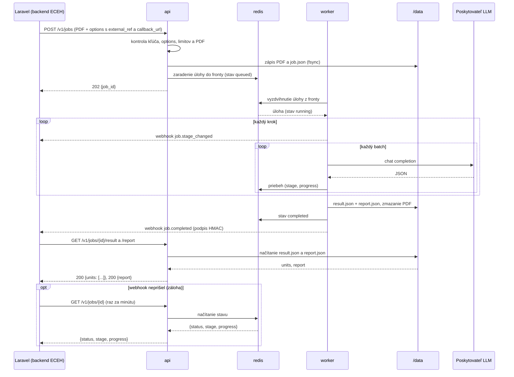
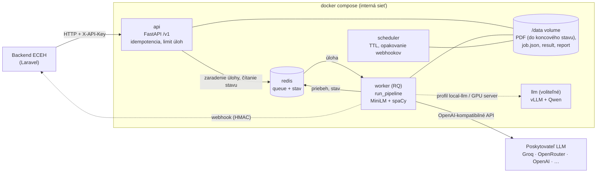
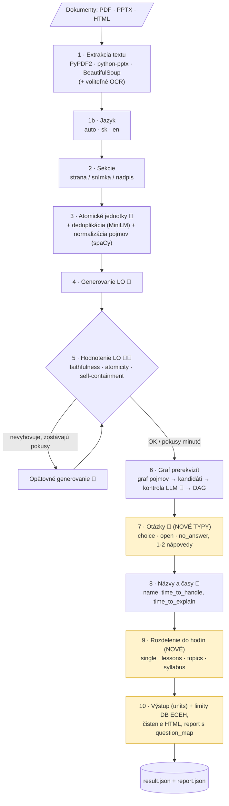

# Mlynček B - Martin Demčák

| **Osoba** | **Úloha** | **Task** |
| --- | --- | --- |
| @Martin Demčák | Zodpovedá za splnenie špecifikácie Mlynčeku B | [SCRUM-34](https://stuba-team-bxgehtkq.atlassian.net/browse/SCRUM-34) |

---

| **Product overview** | |
| --- | --- |
| **Target date** | 24.10.2026 |
| **Document status** | IN-PROGRESS |
| **Team members** | @Martin Demčák |
| **Quick links** | [Prílohy: technické podrobnosti](api-design-appendix.md) |
| **Work tracker** | [SCRUM-34](https://stuba-team-bxgehtkq.atlassian.net/browse/SCRUM-34) |
| **Repository** | <https://github.com/Matik080/LO-Generator/tree/integration> |

## Objective

Cieľom je navrhnúť, ako zo súčasného nástroja (Mlynček B, LO Generator, len obrovský wrapper, it's terrible) spraviť samostatnú službu v Docker kontajneri s REST API.

**Rovnaký API kontrakt ako Mlynček A.** Stránka, ktorá službu volá, pošle jeden alebo viac dokumentov (PDF, pri tool B aj PPTX a HTML) a spôsob rozdelenia: buď "všetko do jednej hodiny", alebo podľa čoho sa má obsah rozdeliť (počet hodín, dĺžka hodiny, tematické celky, sylabus). Služba potom sama spustí všetky kroky:

- extrakciu textu,
- extrakciu atomických jednotiek,
- generovanie vzdelávacích objektov (LO),
- hodnotenie kvality a opätovné generovanie,
- graf prerekvizít,
- generovanie otázok (MCQ nesprávne varianty),
- rozdelenie do hodín.

**Rovnaký kontrakt a rovnaký výstup ako Mlynček A:** Mlynček B používa rovnaký kontrakt ako Mlynček A, teda rovnaké endpointy, rovnaký parameter `split`, rovnaké webhooky a rovnaký výstupný formát. Laravel môže volať oba nástroje rovnako a vymeniť jeden za druhý.

**Výstup:** Výstupom je JSON vo formáte `units`. Každý unit je jedna vyučovacia hodina s názvom, popisom a otázkami daného typu: `choice`, `open` a `no_answer` (s nápovedami, možnosťami a časmi). Pri voľbe "všetko do jednej hodiny" má výstup práve jeden unit.

**Poskytovateľ modelu:** Služba nie je viazaná na jedného poskytovateľa LLM. Tool B už dnes volá modely cez OpenAI kompatibilné API (Groq, OpenRouter, GitHub Models, OpenAI). Rovnaké API by mohol poskytovať aj lokálny model (návrh: vLLM a Qwen približne 27B). Potom by to bola len otázka konfigurácie.

**Nezávislosť od používateľa:** Spracovanie nezávisí od toho, či je používateľ na stránke. Používateľ môže stránku zavrieť a po návrate uvidí hotový výsledok. Služba výsledok uchová, stránka si ho prevezme kedykoľvek a používateľovi sa žiadne upozornenia neposielajú.

**Kto službu volá:** Stránka v tomto dokumente znamená backend ECEH (Laravel). Frontend ani učiteľ službu nevolajú priamo. Laravel kontroluje oprávnenia učiteľa a službu volá jedným servisným API kľúčom.

**Webhook:** Keď sa stav úlohy zmení, služba pošle webhook (HTTP POST so stavom úlohy) na adresu backendu ECEH. Laravel tak nemusí každých pár sekúnd zisťovať, či je úloha hotová. Používateľovi služba stále nič neposiela.

## Success metrics

| **Goal** | **Metric** |
| --- | --- |
| Služba sa dá spustiť jedným príkazom. | `docker compose up` na čistom stroji (iba Docker + `.env`) spustí službu. `GET /health` vráti 200 do 60 s po štarte. |
| Stránke stačí jedno volanie. | Jeden `POST /v1/jobs` (PDF, PPTX alebo HTML + spôsob rozdelenia) spustí všetky kroky. Stránka potom iba číta stav a výsledok (žiadny krok nespúšťa sama). |
| Spracovanie nezávisí od používateľa. | Úloha sa dokončí aj po zatvorení stránky alebo prerušení spojenia. Výsledok je dostupný cez `job_id` alebo `external_ref` počas celej doby uchovania (7 dní). Reštart kontajnerov nespôsobí stratu hotových výsledkov. Nedokončená úloha sa spustí znova. |
| Výstup má presne požadovaný formát. | 100% výstupov prejde validáciou voči JSON schéme formátu `units`, teda bez polí navyše a v rámci dĺžkových limitov DB ECEH (automatické testy pre toto). |
| Otázky sú použiteľné. | Každá `choice` otázka má aspoň 2 možnosti a aspoň 1 správnu (správnych môže byť viac), bez duplicít. `open` má práve 1 vzorovú odpoveď. `no_answer` nemá možnosti. Nápovedy neprezrádzajú odpoveď (overí hodnotenie LLM). |
| Rozdelenie do hodín je korektné. | Súčet `time_to_handle + time_to_explain` v jednom unite (hodine) je v rozmedzí ±20% zadanej dĺžky hodiny. 0 porušení prerekvizít (Tool B už dnes vytvára graf prerekvizít). Žiadna prázdna hodina. |
| Kvalita sa nezhorší. | V referenčnom dokumente je priemerné skóre `Faithfulness` voči zdroju a podiel LO, ktoré prejdú filtrom kvality, aspoň taký ako dnes (východisková hodnota sa zmeria v M1 - Míľniku 1). |
| Model sa dá vymeniť konfiguráciou. | Zmena poskytovateľa LLM alebo embeddingov (cloud alebo lokálny server) je iba zmena premenných prostredia. |
| API odpovedá rýchlo. | Endpointy stavu a výsledku odpovedajú do 200 ms, dlhé spracovanie beží asynchrónne. |
| Webhook oznámi zmenu stavu. | Pri stave `completed`, `failed` a `cancelled` príde webhook do 5 s. Ak backend neodpovie 2xx, služba to skúsi ešte 3-krát. `GET /v1/jobs/{id}` vráti rovnaký stav ako posledný webhook (automatický test). |
| Opakovaná požiadavka nevytvorí druhú úlohu. | Druhý `POST /v1/jobs` s rovnakým `external_ref` vráti rovnaké `job_id` a vo fronte nevznikne nová úloha (automatický test). |
| Odpoveď 202 znamená trvalé prevzatie. | Po odpovedi 202 je PDF v `/data` a úloha vo fronte. Reštart kontajnerov hneď po 202 úlohu nestratí (test odolnosti). |

## Assumptions

- Cieľový formát výstupu (`units.json`) je stanovený a musí sa dodržať presne, bez extra fields. Jeden unit = jedna vyučovacia hodina s názvom (`title`), popisom (`description`) a otázkami. Tool B už dnes vytvára LO v tomto formáte.
- `time_to_handle` (čas na vypracovanie študentom) a `time_to_explain` (čas na vysvetlenie) sú v sekundách, sú to časy jednej otázky a odhaduje ich LLM. Čas hodiny je súčet časov jej otázok. Tool B časy už dnes odhaduje v `enrich_learning_objects`.
- Pole `hints[].url` obsahuje HTML text nápovedy (napr. `
…
`), nie webovú adresu.
- Vstupom sú PDF dokumenty (jeden alebo viac), rovnako ako pri Mlynčeku A. Tool B navyše prijíma aj prezentácie PPTX (vrátane textu z poznámok k snímkam) a HTML stránky, ktoré už dnes vie spracovať. Mlynček A ich neprijíma, takže Laravel ich môže posielať iba do B.
- OCR obrázkov zostáva ako voliteľný krok. Na stretnutí 25. 10. sme sa dohodli, že OCR ostáva. Predvolene je vypnuté, lebo dokument s veľa obrázkami sa spracováva dlho.
- Generovanie ide cez OpenAI-kompatibilné API. Embeddingy predvolene počíta lokálny model MiniLM (malý, beží na CPU, bez nákladov na API). Voliteľne môžu ísť cez API poskytovateľa, nezávisle od poskytovateľa LLM.
- Spracovanie jedného dokumentu trvá minúty, preto API pracuje s asynchrónnymi úlohami (job). Záťaž je nízka (školské použitie). Počet súčasných používateľov nepoznáme, preto sa počet workerov a počet súbežných volaní LLM nastavuje v konfigurácii.
- Stránka si sama pamätá, ktoré úlohy patria ktorému používateľovi (cez `job_id` alebo vlastný `external_ref`). Služba používateľov nepozná a neposiela im upozornenia.
- Službu volá iba Laravel backend ECEH so servisným API kľúčom, cez internú sieť, nikdy priamo prehliadač používateľa. Oprávnenie učiteľa (`users.can_generate`) a právo upravovať predmet kontroluje Laravel ešte pred volaním služby.
- Výber otázok, ich úpravu, presun do inej hodiny a stav kontroly (`unreviewed`, `reviewed`) rieši ECEH. Služba vracia celý výsledok naraz, nie po jednej otázke.
- Kontrolu otázok druhým AI modelom (stav `ai_checked`) tím vyradil. Služba otázky hodnotí ako dnes, skóre sú iba v `/report`.
- Pri generovaní pre jednu existujúcu hodinu pošle Laravel `split.mode = single`. Laravel potom môže ignorovať `title` a `description` z výsledku.

## Milestones

| **Miľník** | **Obsah** |
| --- | --- |
| M0 - Návrh | Tento dokument, schválenie návrhu, uzavretie otvorených otázok. Kontrakt zosúladený s Mlynčekom A. |
| M1 - Refaktor jadra htool | Oddelenie pipeline od HTML stránky a od globálneho stavu do funkcie `run_pipeline`; odstránenie globálnych logov a zdieľaných výstupných súborov, oprava nájdených chýb, meranie východiskovej kvality. |
| M2 - LLM vrstva a konfigurácia | Centrálna konfigurácia z prostredia, nastaviteľné adresy (base URL) a modely, rozhranie `Embedder` (lokálne / API), limit súbežných volaní LLM. |
| M3 - API a úlohy | FastAPI `/v1`, `POST /v1/jobs`, queue úloh (Redis + RQ), stav a priebeh, chybové odpovede. Webhooky, idempotencia cez `external_ref`, retry po `failed`, limit aktívnych úloh. |
| M4 - Nové otázky a formát units | Generovanie `choice` (viac správnych) / `open` / `no_answer`, nápovedy, časy, mapovanie do `units`, JSON schéma. Dĺžkové limity podľa DB ECEH, čistenie HTML, report s väzbou na LO. |
| M5 - Rozdelenie do hodín | Režimy `single` / `lessons` / `topics` / `syllabus` alebo ako si to nastavíme, jedna hodina = jeden unit, validácia. |
| M6 - Docker a dokončenie | Dockerfile, docker-compose, README, example volania, testy. Nasadenie v internej sieti spolu s ECEH (s Adelou). |

## Requirements

Označenia a znenie požiadaviek R1-R22 zodpovedajú stránke Mlynčeka A, takže sa obe stránky dajú porovnať 1:1. R23 má iba Mlynček B. Stĺpec **"Tool B"** hovorí, koľko z toho už existuje v tool B.

| **Requirement** | **User Story** | **Importance** | **Jira Issue** | **Tool B** | **Notes** |
| --- | --- | --- | --- | --- | --- |
| R1 Docker image | Ako správca chcem službu spustiť cez Docker, aby som nemusel inštalovať Python, Torch a ďalšie knižnice. | HIGH | | Čiastočne (Dockerfile existuje, modely sa sťahujú za behu) | Python 3.11-slim, torch CPU, modely zabalené v image. |
| R2 Jedno volanie spustí všetko | Ako stránka chcem poslať dokument a spôsob rozdelenia a nič viac. Všetky kroky nech služba spustí sama. | HIGH |  | Nie (HTML stránka volá kroky jeden po druhom) | `POST /v1/jobs`, FastAPI, prefix `/v1`. |
| R3 Asynchrónne úlohy | Ako stránka chcem sledovať stav, lebo spracovanie trvá rádovo minúty. | HIGH |  | Nie (synchrónne requesty) | 202 + `job_id`, stav, priebeh, zrušenie. |
| R4 Spracovanie bez prítomnosti používateľa | Ako používateľ chcem odísť zo stránky a po návrate vidieť hotový výsledok. | HIGH |  | Nie | Výsledok sa uchová v `/data`, stav úloh prežije reštart. PDF sa zmaže po koncovom stave. |
| R5 Vlastný identifikátor stránky | Ako stránka chcem k úlohe pripojiť svoj identifikátor (napr. používateľa alebo kurzu) a podľa neho úlohy neskôr nájsť. | MEDIUM | - | Nie | `external_ref`, `GET /v1/jobs?external_ref=…`. `external_ref` je unikátny (R17). |
| R6 Výstup vo formáte units | Ako stránka chcem dostať JSON presne v dohodnutom formáte `units`. | HIGH |  | Čiastočne (`echub_format_converter`) | JSON schéma, validácia pred odoslaním. |
| R7 Hodina = unit | Ako učiteľ chcem, aby bol výstup rozdelený na vyučovacie hodiny, každá s názvom a popisom. | HIGH |  | Nie (súčasne 1 unit = 1 zdrojový dokument) | `units[]`: `title`, `description`, `questions`. |
| R8 Spôsob rozdelenia | Ako učiteľ chcem dať všetko do jednej hodiny alebo určiť, podľa čoho sa má obsah rozdeliť. | HIGH |  | Nie | `single`, `lessons`, `topics`, `syllabus` alebo podľa neskôr dohodnutého rozdelenia tímom |
| R9 Nové typy otázok | Ako učiteľ chcem otázky s možnosťami, otvorené otázky a úlohy bez vyhodnotenia, s nápovedami a časmi. | HIGH |  | Čiastočne (`choice` s 1 správnou odpoveďou, `open`, 1 nápoveda, časy) | `choice` (aj viac správnych), `open`, `no_answer` (nevyhodnocuje sa), 1 až 2 nápovedy, časy odhaduje LLM. |
| R10 Nezávislosť od poskytovateľa LLM | Ako správca chcem použiť model iného výrobcu alebo lokálny model bez zmeny kódu. | HIGH | | Čiastočne (OpenAI-kompatibilné API, ale pevné adresy a poskytovatelia) | OpenAI-kompatibilný adaptér pokrýva Groq, OpenRouter, OpenAI, Mistral, Gemini (OpenAI-kompatibilný endpoint), Ollama, vLLM; adaptér pre Anthropic iba v prípade potreby. |
| R11 Embeddingy cez API alebo lokálnym modelom | Ako správca chcem embeddingy počítať cez API zvoleného poskytovateľa alebo lokálnym modelom. | MEDIUM | - | Čiastočne (iba lokálny MiniLM) | Rozhranie `Embedder`: lokálny MiniLM (predvolený) alebo API, vlastný poskytovateľ nezávislý od LLM, prahy podľa modelu. |
| R12 Konfigurácia cez prostredie | Ako správca chcem meniť modely, prahy a limity bez úpravy kódu. | MEDIUM | - | Čiastočne (`GEN_MODEL`, `INTER_CALL_DELAY`, `REASONING_EFFORT` v .env) | pydantic-settings, `.env.example` (premenovaný z `env_template`), prefix `LOGEN_`. |
| R13 Chyby a limity | Ako stránka chcem jasné chybové odpovede (zlý súbor, veľký súbor, chyba LLM). | MEDIUM | - | Čiastočne (iba nepodporovaný typ súboru) | Jednotný formát chyby. |
| R14 OpenAPI dokumentácia | Ako vývojár stránky chcem vidieť popis API a vyskúšať ho v prehliadači. | MEDIUM | - | Áno (FastAPI `/docs`) | `/docs` a `/openapi.json`. |
| R15 Voliteľné OCR | Ako správca chcem OCR zapnúť alebo vypnúť podľa typu dokumentov. | LOW | - | Nie | Parameter `extraction.ocr`. OCR ostáva, predvolene vypnuté. Image bez OCR cez `INSTALL_OCR=false`. |
| R16 Webhook pre backend | Ako backend chcem dostať správu o zmene stavu úlohy, aby som sa nemusel stále pýtať. | HIGH | | Nie | `options.callback_url`, podpis HMAC, 3 opakovania. Polling ostáva ako záloha. |
| R17 Opakovaná požiadavka bez duplicity | Ako backend chcem po výpadku spojenia znova poslať požiadavku a nevytvoriť druhú úlohu. | HIGH | | Nie | Unikátny `external_ref`. Rovnaký `external_ref` vráti existujúce `job_id`. |
| R18 Trvalé prevzatie pri 202 | Ako backend chcem po 202 zmazať svoju kópiu PDF. | HIGH | | Nie | 202 až po zápise PDF a `job.json` do `/data` a zaradení do fronty. |
| R19 Výstup podľa limitov DB ECEH | Ako backend chcem uložiť výsledok bez chyby dĺžky stĺpca. | HIGH | | Nie | `maxLength` v JSON schéme, čistenie HTML v nápovedách. |
| R20 Report pre learning objekty | Ako backend chcem vedieť, ku ktorému LO patrí každá otázka. | MEDIUM | | Čiastočne (LO majú `id`, väzba na otázku zatiaľ nie) | `/report`: `learning_objects[]` a `question_map[]`. |
| R21 Mazanie vstupov a retry | Ako správca nechcem držať nahraté dokumenty dlhšie, ako treba. | MEDIUM | | Nie | PDF sa zmaže po `completed` alebo `cancelled`. Po `failed` ostane 24 h pre `POST /v1/jobs/{id}/retry`. |
| R22 Ochrana pred preťažením | Ako správca chcem obmedziť počet súčasných úloh. | MEDIUM | | Nie | `LOGEN_MAX_ACTIVE_JOBS`, odpoveď `429 too_many_jobs`. |
| R23 Bezpečnosť **(B)** | Ako správca chcem, aby službu mohol volať iba náš backend a aby sa cez ňu nedalo dostať k cudzím úlohám ani do systému. | HIGH | | Nie (žiadne overenie, kap. 1) | Povinný API kľúč pri nasadení s ECEH, UUID `job_id`, povolené adresy webhookov, Redis s heslom (kap. 12). |

## Out of Scope

- Samotná implementácia (SCRUM-34 je iba návrh a dokument).
- HTML stránka (`pipeline_ui.html`) ako klient služby. Môže zostať ako nástroj pre vývojárov nad starými endpointmi, ale nie je súčasťou kontraktu.
- Súčasné pomocné endpointy `/statistics`, `/add-sources`, `/save-los`. Pridanie zdrojov k hotovému výsledku = nová úloha.
- Preusporiadanie hotových výsledkov do iného počtu hodín bez nového spracovania. Nové rozdelenie = nová úloha.
- Opätovné generovanie z toho istého PDF po dokončení úlohy. Nové generovanie je nová úloha s novým nahratím PDF.
- Správa používateľov a roly. Stačí jednoduchý API kľúč.
- Upozornenia používateľovi o dokončení (e-mail, notifikácie). Webhook pre backend ECEH už je v rozsahu (R16). Učiteľovi stav ukáže ECEH.
- Iné vstupné formáty ako PDF, PPTX a HTML (napr. DOCX). Tie musí učiteľ najprv uložiť ako PDF.
- Výber, úprava a presun otázok pred uložením, stav kontroly otázky a autorstvo. Toto rieši ECEH (Backend, Databáza).
- Trénovanie alebo dolaďovanie (fine-tuning) vlastného modelu.
- GPU akcelerácia, horizontálne škálovanie a Kubernetes.

## Design

### 1. Súčasný stav

Súčasne proces riadi HTML stránka `fastapi/pipeline_ui.html`, ktorá postupne volá `/extract-units` → `/generate-los` → `/evaluate` → `/build-graph` → `/export-echub` (v `fastapi/main.py`). Každý endpoint vráti výsledok prehliadaču a prehliadač ho pošle do ďalšieho kroku. Pri prerábaní treba vyriešiť tieto problémy:

| Problém v súčasnom kóde | Dôsledok | Riešenie v návrhu |
| --- | --- | --- |
| Kroky riadi prehliadač a drží aj stav (megabajty JSON medzi volaniami). | Pipeline sa nedá spustiť jedným volaním, ale na backende táto postupnosť existuje, len bude musieť byť prerobená, aby sedela na endpoints | Jedna funkcia `run_pipeline(params, progress_callback)`, všetko spustí worker. |
| Každý endpoint beží synchrónne niekoľko minút (zdieľaný `ThreadPoolExecutor(max_workers=2)`). | HTTP request vyprší, pri výpadku spojenia sa práca stratí. | Asynchrónne úlohy cez queue a worker. |
| Logy a priebeh sú globálne: `sys.stdout` je presmerovaný do jednej `_log_queue` a `_current_stage` je globálna premenná. | Súbežné úlohy si miešajú logy, priebeh za jednotlivú úlohu neexistuje. | `progress_callback` pre každú úlohu, uložený v Redise, logovanie po úlohách. |
| Výstupy sa zapisujú na pevné cesty `/app/output/*.json` (`_save`). | Súbežné úlohy by si prepisovali súbory. | Kroky vracajú dáta, zápis rieši vrstva úloh do `/data/jobs/{id}/`. |
| `filter_and_regenerate` (`ems.py`) číta `atomic_units.json` z disku. | Skrytá závislosť na disku (`/evaluate` to obchádza dočasným priečinkom). | Jednotky sa odovzdávajú v pamäti. |
| Grafy sa vracajú ako gpickle v base64. | Klienti mimo Pythonu ich neprečítajú, rozbaľovanie pickle nie je bezpečné. | Graf ako JSON (node-link) a iba v `/report`. |
| `llm_service.py` vyberá poskytovateľa pri importe, má pevné adresy (hodnoty `*_BASE_URL` v `env_template` sa ignorujú) a bez kľúča zavolá `exit(1)`. | Zmena poskytovateľa = zmena kódu, služba spadne namiesto toho, aby nahlásila chybu. | Konfigurácia z prostredia pri štarte (pydantic-settings), problém nahlási `/health` a `/v1/info`. |
| Výstup: `choice` má iba jednu správnu odpoveď (`mc_correct_index`), 1 nápovedu, chýba `no_answer`, 1 unit = 1 zdrojový dokument. | Nezodpovedá dohodnutému formátu `units` ani rozdeleniu do hodín. | Nové typy otázok, 1-2 nápovedy, krok `split` (kap. 8). |
| Text z LLM nemá dĺžkové limity a HTML nápovedy sa nečistí. | Insert do DB ECEH by zlyhal pri dlhom texte. Nebezpečné HTML by sa zobrazilo študentom. | Limity podľa DB ECEH a čistenie HTML pred uložením výsledku (kap. 6). |
| Dodatočné spracovanie LO (id, kľúčové slová, zdroj v nápovede) je skopírované 3× (`main.py` dvakrát, `ems.py`). | Opravy treba robiť na troch miestach. | Jedna spoločná pomocná funkcia. |
| Žiadny endpoint nemá overenie prístupu. `/save-los` zapisoval súbor s menom z requestu (napr. `../main.py`), `/logs` posiela všetky logy komukoľvek, upload nemá limit veľkosti. | Ktokoľvek, kto sa dostane na port 8000, môže spúšťať úlohy na náš účet LLM, čítať logy a (do opravy) prepísať kód aplikácie. | Zápis cez `/save-los` je už opravený (povolené iba meno `*.json` bez ciest). Zvyšok rieši nové API (kap. 3, 12). Do prerobenia sa súčasný kontajner nemá vystavovať mimo localhost. |

### 2. Typický scenár volania

Scenár je rovnaký ako pri Mlynčeku A. Stránka nepozná jednotlivé kroky spracovania, pošle jeden request a služba spraví zvyšok sama.

1. Laravel pošle `POST /v1/jobs`: PDF, PPTX alebo HTML dokument a parameter `split`, napr. "všetko do jednej hodiny" (`mode: single`) alebo "rozdeľ podľa tematických celkov na hodiny po 45 minút" (`mode: topics`). Pridá aj `external_ref` a `callback_url`.
2. Služba skontroluje dokument, uloží ho do `/data` a zaradí úlohu do fronty. Až potom odpovie `202 Accepted` a vráti `job_id`. Laravel po 202 môže zmazať svoju kópiu PDF.
3. Worker sám spustí všetky kroky: extrakcia → jazyk → atomické jednotky → LO → hodnotenie LO a opätovné generovanie → graf prerekvizít → otázky → odhad časov → rozdelenie do hodín → zostavenie výsledného JSON.
4. Pri zmene kroku a pri koncovom stave pošle worker webhook na `callback_url`.
5. Laravel si `job_id` uloží k záznamu `generations`. Používateľ môže stránku zavrieť, spracovanie beží ďalej.
6. Po webhooku `completed` Laravel stiahne výsledok (`GET /v1/jobs/{id}/result`) a report (`GET /v1/jobs/{id}/report`). Výsledok je JSON presne vo formáte `units`, kde každý unit je jedna hodina.
7. Ak webhook nepríde, Laravel zistí stav sám cez `GET /v1/jobs/{id}`, napríklad raz za minútu. Ak `job_id` nemá (napríklad po timeoute pri odoslaní), nájde úlohu cez `GET /v1/jobs?external_ref=…`.

### 3. Architektúra

Služba sa skladá z troch hlavných kontajnerov, rovnako ako Mlynček A: API, worker a Redis. Pomocný kontajner scheduler maže staré súbory a opakuje webhooky. API prijíma requesty a vracia stav a výsledky. Dlhé spracovanie robí worker, ktorý si úlohy berie z fronty v Redise. LLM volá worker cez API zvoleného poskytovateľa. Ak sa nasadí lokálny model, beží ako ďalší voliteľný kontajner alebo na samostatnom GPU serveri.

Worker posiela webhooky na backend ECEH. Kontajnery sú v internej sieti. Port API nie je dostupný z internetu, dostane sa k nemu iba Laravel.

| Komponent | Technológia | Zodpovednosť |
| --- | --- | --- |
| api | FastAPI + Uvicorn, Pydantic v2 | Validácia vstupu, nahratie PDF, vytvorenie úlohy, stav, výsledky, OpenAPI dokumentácia, API kľúč. Idempotencia cez `external_ref`, limit aktívnych úloh. |
| worker | RQ (Redis Queue), rovnaký obraz ako api | Spustí všetky kroky pipeline, hlási priebeh, uloží výsledný JSON a report do `/data`. Posiela webhooky a maže vstupné PDF. Obsahuje lokálne modely MiniLM a spaCy. |
| scheduler | `rqscheduler`, rovnaký obraz | Mazanie PDF a výsledkov po TTL, opakovanie webhookov. |
| redis | `redis:7-alpine` (appendonly) | Queue úloh, stav úlohy, priebeh (stage, progress). |
| /data (volume) | Docker volume | Nahraté PDF a výsledky úloh, mazanie po TTL (7 dní). PDF iba do koncového stavu úlohy. |
| llm (voliteľné) | vLLM (alebo Ollama), GPU | Lokálny model s OpenAI-kompatibilným API. Zapne sa profilom `local-llm`. Návrh modelu: Qwen, približne 27B (rešerš Adela). Pravdepodobne pobeží na samostatnom serveri s GPU. |

**Spracovanie bez prítomnosti používateľa**

- **Úloha nie je viazaná na spojenie.** Worker spracúva úlohu z queue a o stránke ani o prehliadači nevie. Zatvorenie stránky alebo výpadok spojenia spracovanie nezastaví.
- **Trvalé uloženie.** Každá úloha má priečinok `/data/jobs/{id}/`, v ktorom sú:
  - `job.json`: stav, parametre, `external_ref`, čas vytvorenia;
  - nahraté PDF (iba do koncového stavu);
  - `result.json` a `report.json`.

  Redis ukladá dáta na disk (appendonly), takže queue prežije reštart.
- **Reštart počas spracovania.** Ak worker spadne alebo sa reštartuje, nedokončená úloha sa vráti do queue a spustí sa znova od začiatku: max. 2 pokusy, potom `failed`. *Neskôr:* pokračovanie od posledného dokončeného kroku, keďže B už má mechanizmus checkpointov v `ems.process_book_with_checkpoints`. Hotové výsledky sa nestrácajú.
- **Doba uchovania.** Výsledky sú dostupné 7 dní (`LOGEN_RESULT_TTL_DAYS`), potom ich služba zmaže.

**Význam odpovede 202**

Služba vráti `202 Accepted` až po týchto krokoch:

1. API skontroluje API kľúč, `options` a limity (počet súborov, veľkosť, počet strán).
2. API skontroluje, že súbor je PDF (začína `%PDF`), dá sa otvoriť a nie je zaheslovaný. Pri PPTX **(B)** skontroluje, že je to platný ZIP balík prezentácie, dá sa otvoriť cez python-pptx a po rozbalení neprekročí `LOGEN_MAX_UNZIPPED_MB` (ochrana pred ZIP bombou). Pri HTML **(B)** skontroluje, že je to text v UTF-8, dá sa spracovať cez BeautifulSoup a obsahuje aspoň jeden textový blok.
3. API zapíše PDF a `job.json` do `/data/jobs/{id}/` a zavolá `fsync`.
4. API zaradí úlohu do fronty v Redise (appendonly).

Odpoveď 202 preto znamená trvalé prevzatie dokumentov. Laravel po nej môže zmazať svoju dočasnú kópiu PDF. Ak niektorý krok zlyhá, služba vráti chybu 4xx alebo 5xx a úloha nevznikne.

**Mazanie vstupov a opakovanie po chybe**

- Po stave `completed` alebo `cancelled` worker zmaže nahraté PDF. Výsledok a report ostanú 7 dní.
- Po stave `failed` ostane PDF ešte 24 hodín (`LOGEN_FAILED_INPUT_TTL_HOURS`). V tom čase môže Laravel zavolať `POST /v1/jobs/{id}/retry`. Úloha dostane stav `queued` a rovnaké `job_id`.
- Po 24 hodinách služba PDF zmaže. Retry potom vráti `409 job_not_retryable` a Laravel musí vytvoriť novú úlohu s novým nahratím PDF.
- Laravel môže po uložení návrhu zavolať `DELETE /v1/jobs/{id}`. Služba potom hneď zmaže výsledok aj report.

**Webhook pre backend ECEH**

Laravel pošle v `options` adresu `callback_url`. Worker na ňu pošle HTTP POST pri týchto udalostiach:

- `job.stage_changed`: worker začal nový krok (napríklad `questions`). Pri jednom kroku pošle najviac jednu správu.
- `job.completed`, `job.failed`, `job.cancelled`: úloha skončila.

Telo správy obsahuje iba stav: `job_id`, `external_ref`, `status`, `stage`, `progress`, `error` a čas. Výsledok v ňom nie je, Laravel si ho stiahne cez `/result` a `/report`. Služba telo podpíše hlavičkou `X-QGen-Signature` (HMAC-SHA256 s tajným kľúčom `LOGEN_WEBHOOK_SECRET`) a Laravel podpis skontroluje. Názvy hlavičiek sú rovnaké ako pri Mlynčeku A, aby Laravel overoval oba mlynčeky rovnakým kódom.

Ak Laravel neodpovie kódom 2xx do 5 s, služba to skúsi znova po 10 s, 60 s a 300 s. Chyba doručenia nemení stav úlohy, polling cez `GET /v1/jobs/{id}` preto ostáva ako záloha. Služba posiela webhooky iba na adresy z `LOGEN_WEBHOOK_ALLOWED_HOSTS`, aby sa API nedalo zneužiť na volanie iných adries.

Webhook rieši iba komunikáciu služba → Laravel. Komunikáciu Laravel → frontend (polling alebo SSE) navrhuje Backend stránka.

**Opakovaná požiadavka (idempotencia)**

Idempotentná požiadavka je bezpečná pri opakovanom poslaní. `external_ref` je v službe unikátny pre jeden API kľúč.

- Ak príde `POST /v1/jobs` s `external_ref`, ktorý už existuje, služba nevytvorí novú úlohu. Vráti `200 OK` s pôvodným `job_id` a stavom. Nové PDF ignoruje.
- Ak Laravel nedostane odpoveď (timeout), môže POST bezpečne zopakovať s rovnakým `external_ref`. Druhá možnosť je `GET /v1/jobs?external_ref=…` (stav `upload_uncertain` na Backend stránke).
- Pre ECEH je `external_ref` povinný. Laravel posiela `generations.external_ref`.

**Prístup a ochrana služby**

- Službu volá iba Laravel. Má jeden servisný kľúč v `LOGEN_API_KEYS`. Učitelia a frontend kľúč nedostanú.
- Port 8000 je dostupný iba v internej sieti docker compose alebo servera. Služba nemá verejnú adresu.
- Služba prijme najviac `LOGEN_MAX_ACTIVE_JOBS` úloh v stave `queued` alebo `running` (predvolene 10). Ďalšiu odmietne kódom `429 too_many_jobs` s hlavičkou `Retry-After`.
- Log obsahuje `job_id`, `external_ref`, krok a typ chyby. Neobsahuje text dokumentu ani API kľúče.

Ďalšie bezpečnostné opatrenia, ktoré má iba B, sú v kap. 12.

### 4. Kroky spracovania

Prvé kroky zostávajú ako sú v súčasnej verzii (prompty a logika pochádzajú z bakalárskej práce). Mení sa generovanie otázok (nové typy) a pribudnú kroky `split` a `output`. LO, graf prerekvizít a hodnotenia zostávajú interné: slúžia na generovanie otázok a na určenie poradia a tém. Vo výstupnom formáte nie sú, nájdu sa iba v `/report`.

🤖 = volanie LLM (externý poskytovateľ). Všetko ostatné beží lokálne na CPU.

| # | Krok | Kód dnes | Zmena |
| --- | --- | --- | --- |
| 1 | Extrakcia textu | `utilities.extract_text_from_source` | voliteľné OCR pre strany bez textu. PPTX **(B)**: 1 snímka = 1 sekcia, vrátane poznámok. HTML **(B)**: 1 sekcia = blok pod nadpisom `h1`-`h3`, bez `script`, `style`, `nav` a `footer` |
| 1b | Jazyk | - | nové: `options.language` (`auto` = rozpoznanie `sk`/`en` z textu), pričom prompty dostanú jazyk výstupu. Normalizáciu pojmov v slovenčine treba overiť (spaCy je dnes iba anglický) |
| 2 | Sekcie | `utilities.split_into_sections` | bez zmeny |
| 3 | Atomické jednotky | `atomic_unit_extractor.extract_atomic_units_batch`, `clean_atomic_units`, `concept_normalizer.normalize_units` | nastaviť `source_title`/`source_page`, embeddingy cez `Embedder` |
| 4 | LO | `learning_object_generator.generate_learning_object_batch` | spoločná funkcia na dodatočné spracovanie |
| 5 | Hodnotenie LO | `ems.filter_and_regenerate`, `learning_object_evaluator.evaluate_learning_objects_batch` | jednotky v pamäti namiesto z disku |
| 6 | Graf | `graph_builder.build_concept_graph`, `build_layered_learning_paths`, `verify_prerequisites_batched`, `store_prerequisites` | bezpečnejšie odstraňovanie cyklov, JSON namiesto pickle |
| 7 | Otázky | `generate_mc_variants_batch` (choice s 1 správnou odpoveďou) | nové prompty pre `choice` s viacerými správnymi / `no_answer` (kap. 7) |
| 8 | Názvy a časy | `echub_format_converter.enrich_learning_objects` | orezanie časov na rozsah podľa typu |
| 9 | Rozdelenie do hodín | - | nový modul (kap. 8) |
| 10 | Výstup | `echub_format_converter.lo_to_question`, `convert_by_source` | mapovanie do hodín, dĺžkové limity, čistenie HTML, validácia voči JSON schéme, report s `question_map` |

Každá funkcia pipeline dostane voliteľný parameter `progress_callback(stage, done, total)`. Cykly cez batche už vedia, pri ktorom batchi sú (dnes to iba vypisujú). Worker zapisuje priebeh do Redisu, takže stránka vidí napríklad "questions, 62%". Pri zmene kroku worker pošle webhook `job.stage_changed`.

Krok `output` skontroluje dĺžkové limity a prečistí HTML v nápovedách (kap. 6). Krok `output` zostaví aj report s väzbou otázok na LO.

### 5. LLM vrstva - iní providers a lokálny model

Tool B volá modely na jednom mieste: `call_llm` v `llm_service.py`, cez SDK `openai`. Funkcia už obsahuje opakovanie pokusov, čakanie pri limite požiadaviek (`RateLimitError`) a smerovanie niektorých modelov cez OpenRouter (`LEGACY_ROUTES`, `OPENROUTER_MODELS`). To pokrýva väčšinu práce, chýba len konfigurovateľnosť.

| Adaptér | Pokrýva | Generovanie / embeddingy |
| --- | --- | --- |
| OpenAICompatibleAdapter (existuje už dnes, dostane nastaviteľnú `base_url`) | Groq, OpenRouter, OpenAI, Mistral, GitHub Models, Gemini (OpenAI-kompatibilný endpoint), lokálny server (Ollama, vLLM, LM Studio) | áno / áno (`/v1/chat/completions`, `/v1/embeddings`) |
| LocalEmbedder (existuje už dnes: `embedding_service.py`) | `all-MiniLM-L6-v2` na CPU vo workeri | - / áno (predvolený) |
| AnthropicAdapter (iba v prípade potreby) | Claude modely | áno / nie (embeddingy od iného poskytovateľa) |

**Zásady**

- **Výber cez konfiguráciu.** Poskytovateľ a model sa dajú nastaviť zvlášť pre generovanie, hodnotenie (`LOGEN_LLM_MODEL_EVAL`, dnes napevno v `main.py` a `ems.py`) a embeddingy.
- **Embeddingy sú vždy k dispozícii.** Služba ich potrebuje na deduplikáciu jednotiek, témy pri rozdelení a priradenie podľa sylabu. Predvolene zostáva lokálny MiniLM: malý model (~90 MB), beží na CPU, nič nestojí a nepotrebuje sieť. Cez `LOGEN_EMBED_PROVIDER=openai_compatible` + `LOGEN_EMBED_BASE_URL` sa dajú počítať cez API poskytovateľa (R11) bez zmeny kódu. Poskytovateľ embeddingov sa nastavuje zvlášť od poskytovateľa LLM, takže aj pri lokálnom LLM môžu embeddingy ostať lokálne alebo ísť cez cloud. Ak embedding API zlyhá aj po opakovaniach, úloha skončí stavom `failed` s kódom `llm_error`.
- **Opakovanie a chyby** zostávajú v `call_llm`. Pribudne časový limit volania a namiesto `exit(1)` funkcia vyhodí zrozumiteľnú výnimku, ktorú úloha nahlási ako `llm_auth` / `llm_error`.
- **Súbežné volania.** Všetky volania LLM sú obmedzené semaforom podľa `LOGEN_LLM_MAX_CONCURRENCY` (predvolene 4 na jeden worker).
- **JSON výstup.** Adaptér zapne JSON režim, ak ho poskytovateľ má. `utilities.parse_json` (vrátane opráv escape sekvencií) a čiastočná obnova JSON v hodnotiacom module zostávajú.
- **Prahy podľa embedding modelu.** Prah deduplikácie (`similarity_threshold = 0.82` v `clean_atomic_units`) platí pre MiniLM. Pri inom modeli sa nakalibruje na referenčnom dokumente a uloží v konfigurácii.
- **Batche a kontextové okno.** Veľkosti batchov (dnes 3 sekcie pri extrakcii, 5 jednotiek pri generovaní, veľkosti podľa modelu v `MODEL_BATCH_SIZES` v hodnotiacom module) sa presunú do konfigurácie.
- **Jazyk.** Prompty a model spaCy sú dnes v angličtine. Slovenské zdroje treba overiť (otvorená otázka).
- **Lokálny model.** Adela navrhla server vLLM a model Qwen s približne 27 miliardami parametrov. vLLM spracuje viac požiadaviek naraz. Tool B sa na takom modeli už testuje (`qwen/qwen3.8-27b` je jeden z hodnotiacich modelov). Model treba overiť na slovenskom texte a na referenčnom dokumente. Hardvér zatiaľ nie je vybavený.

### 6. Výstupný formát (units)

Výstup je jeden JSON presne podľa dohodnutého formátu, rovnako ako pri Mlynčeku A. Pole `units` obsahuje vyučovacie hodiny, každá hodina má názov, popis a zoznam otázok. Do formátu nepridávame žiadne ďalšie polia. Údaje navyše sú v samostatnom endpointe `GET /v1/jobs/{id}/report`: zdroje a strany, typy LO, prerekvizity, skóre hodnotenia, graf a varovania.

Stĺpec **Limit v ECEH** je rovnaký ako pri Mlynčeku A. Hodnoty sú zo stránky Databáza (Viktor Bejtic). JSON schéma ich má ako `maxLength`.

| Pole | Význam | Ako ho vyplníme | Limit v ECEH |
| --- | --- | --- | --- |
| `units[]` | Vyučovacie hodiny | Výsledok rozdelenia (kap. 8). Pri `single` práve jeden unit. | `units` + `activity_unit` |
| `units[].title` | Názov hodiny | LLM podľa LO v hodine. V režime `topics` názov témy, v režime `syllabus` názov od učiteľa. | `units.title`, 255 |
| `units[].description` | Popis hodiny | 1-2 vety z LLM, v režime `syllabus` popis od učiteľa, ak ho poslal. | `units.description`, 4000 |
| `questions[].name` | Krátky názov otázky | `generated_name` z `enrich_learning_objects` (5-8 slov). Dnes sa pridáva prefix `[Module X]` podľa zdroja, ten sa presunie do reportu, aby sa v rámci hodiny neopakoval. | `events.header`, 255 |
| `questions[].description` | Zadanie otázky alebo úlohy | Pole `question` z LO, pri `no_answer` zadanie úlohy. | `events.message`, 4000 |
| `questions[].type` | `choice` \| `open` \| `no_answer` | Podľa typu otázky (kap. 7). | `event_type_id` 1 / 3 / 7 |
| `questions[].time_to_handle` | Čas na vypracovanie (s) | Odhad LLM, orezaný na rozsah podľa typu. | int, sekundy |
| `questions[].time_to_explain` | Čas na vysvetlenie (s) | Odhad LLM, orezaný na rozsah podľa typu. | int, sekundy |
| `questions[].hints[]` | Nápovedy `{name, url}` | `name` = úroveň (napr. "Ľahká nápoveda"), `url` = HTML text nápovedy (`
…
`). | `helps.name` 50, `helps.url` 2000 |
| `questions[].choices[]` | Možnosti `{text, is_correct}` | `choice`: možnosti, správnych môže byť viac, `open`: 1 vzorová odpoveď, `no_answer`: prázdne. | `options.answer_data` 4000 |

**Dĺžkové limity a čistenie HTML** (rovnako ako pri Mlynčeku A)

1. Prompt dá LLM limity pre každé pole.
2. Ak je text dlhší, služba požiada LLM o skrátenie (jedno opakovanie).
3. Ak je `name` stále dlhší, služba ho skráti na koniec slova. Pri `title`, `description`, `choices` a `hints` služba text neskracuje. Otázku vyradí a do reportu zapíše varovanie `field_too_long`.
4. Služba prečistí HTML v `hints[].url`. Povolené značky: `p`, `br`, `strong`, `em`, `ul`, `ol`, `li`, `code`, `pre`, `sub`, `sup`. Ostatné značky a všetky atribúty (aj `onclick`, `style`) odstráni.
5. Názov nápovedy (`hints[].name`) má najviac 50 znakov, napríklad "Ľahká nápoveda".

Celý príklad je v [Prílohách](api-design-appendix.md#výsledok-get-v1jobsidresult).

**Mapovanie zo súčasného výstupu B**

| Dnes (`learning_objects.json`, ECHub export) | Formát units |
| --- | --- |
| ECHub: 1 unit = 1 zdrojový dokument (`convert_by_source`) | `units[]` = hodiny z rozdelenia; `title`, `description` z LLM |
| `question` | `description` |
| `generated_name` (+ prefix `[Module X]`) | `name` (bez prefixu) |
| `mc_options` + `mc_correct_index` (práve 1 správna) | `type: choice`, `choices[{text, is_correct}]`, správnych môže byť viac |
| `answer` (LO bez `mc_options`) | `type: open`, `choices: [{text: answer, is_correct: true}]` |
| - (neexistuje) | `type: no_answer` (úloha bez vyhodnotenia) |
| `hint` (1 reťazec + `[Source: …]`) | `hints: [{name, url: "
…
"}]`, 1-2 úrovne. Zdroj sa presunie do reportu |
| `time_to_handle`, `time_to_explain` | rovnaké, fitnuté na rozsah |
| `id`, `keywords`, `anchor` (téma) | nie sú vo formáte. `/report`: `learning_objects[]` a `question_map[]` (pre tabuľky `learning_objects`, `tags` a `lo_ref` v ECEH) |
| `type` (definition, rule…), `source_statement`, `source_title`, `source_page`, `prerequisite_ids`, `expected_output`, hodnotenia | nie sú vo formáte, dostupné v `/v1/jobs/{id}/report` |
| `concept_graph_b64`, `knowledge_graph_b64` (gpickle) | graf ako JSON v `/report` |

**Report pre DB ECEH (`GET /v1/jobs/{id}/report`)**

Formát `units` nesmie mať polia navyše. Väzbu otázky na learning objekt preto služba vracia v reporte. Laravel z neho naplní `generation_questions.lo_ref`, `learning_objects` a `tags` (stránka Databáza). Otázku určuje dvojica `unit` (index v `units`) a `question` (index v `questions`). Spoločné polia reportu sú rovnaké ako pri Mlynčeku A, údaje, ktoré má iba B (prerekvizity, graf, skóre podľa modelov), sú v samostatnom objekte `extensions`. Presný tvar je v [Prílohe A](api-design-appendix.md#report-get-v1jobsidreport).

- `learning_objects[]`: `id`, `title`, `statement`, `lo_type`, `source` (súbor a strany), `keywords[]`, `bloom_level`, `topic`.
- `question_map[]`: `unit`, `question`, `lo_id`.
- `quality`: skóre faithfulness, answerability a pokrytie tém.
- `warnings[]`: varovania rozdelenia a vyradené otázky (`code`, `message`).
- `timings`: čas každého kroku v sekundách.

### 7. Generovanie nových typov otázok

Generovanie otázok (`learning_object_generator.py`) sa upraví tak, aby LLM rovno vracalo polia potrebné pre formát `units`. Vstup zostáva rovnaký: LO a jeho atomická jednotka (zdrojová pasaž). Pri `no_answer` aj susedné jednotky tej istej témy.

| Typ | Čo LLM vygeneruje | Kontrola |
| --- | --- | --- |
| `choice` | Zadanie, 3-5 možností z toho istého učiva, správnych môže byť jedna alebo viac, 1-2 nápovedy. Dnešné distraktory (`generate_mc_variants_batch`) sa rozšíria o viac správnych odpovedí. Iba pre typy LO, kde to dáva zmysel (dnes `MC_ELIGIBLE_TYPES`: definition, rule, property, fact, constraint, theorem). | Aspoň 2 možnosti a aspoň 1 správna, bez duplicít. Hodnotenie overí, že `is_correct` pri každej možnosti zodpovedá textu (rozšíri sa dnešné kritérium `distractor_plausibility`). |
| `open` | Zadanie, vzorová odpoveď (dnešné `answer` z LO, pri `algorithm_step`/`example` aj `expected_output` v odpovedi), 1-2 nápovedy. | Práve 1 položka v `choices` s `is_correct: true`. Faithfulness, Atomicity a Self-Contained ako dnes (`filter_and_regenerate`). |
| `no_answer` (nové) | Úloha, ktorá sa nevyhodnocuje. Téma vychádza zo skupiny LO/jednotiek s rovnakým pojmom `anchor`. Nápovedy sú voliteľné. | Prázdne `choices`. Zadanie je jasné a súvisí s učivom (nové kritérium hodnotenia). |

- **Nápovedy** majú úrovne (ľahká a ťažšia) a nesmú prezradiť odpoveď. Hodnotiaci modul ich už dnes hodnotí (`hint_quality`). LO so zavádzajúcou nápovedou sa vygenerujú znova.
- **Časy** odhadne LLM (`enrich_learning_objects`) podľa náročnosti otázky. Hodnota sa oreže na povolený rozsah podľa typu (tabuľka nižšie); ak chýba, použije sa predvolená. Časy v tabuľke platia pre jednu otázku, nie pre celú hodinu. Čas hodiny je súčet časov jej otázok (kap. 8).
- **Hodnotenie** (faithfulness, clarity, atomicity, self-containment, hint quality) zostáva a filtruje otázky ako dnes. Prahy (`faithfulness_threshold`, `hint_quality_threshold`, `max_attempts`) sa presunú do konfigurácie.
- **Uloženie v ECEH.** ECEH ukladá `open` ako typ 3 (Doplňovacia) a odpoveď hodnotí ručne alebo presnou zhodou. Pri krátkych otázkach preto LLM píše stručnú vzorovú odpoveď. Dlhé vzorové riešenie ostáva iba pri praktických úlohách (`algorithm_step`, `example`). `no_answer` ECEH ukladá ako typ 7 (Bez odpovede).

| Typ | time_to_handle (s) | time_to_explain (s) | Predvolené |
| --- | --- | --- | --- |
| `choice` | 30 - 180 | 0 - 90 | 120 / 30 |
| `open` | 120 - 900 | 0 - 180 | 300 / 0 |
| `no_answer` | 0 - 1800 | 0 - 600 | 300 / 0 |

Rozsahy sú rovnaké ako pri Mlynčeku A, takže oba nástroje dávajú porovnateľné hodiny.

### 8. Rozdelenie do hodín

Stránka v parametri `split` určí, či sa má všetko dať do jednej hodiny, alebo podľa čoho sa má obsah rozdeliť. Výsledkom je vždy jeden JSON s N položkami v `units` (N hodín), v režime `single` je N = 1. Režimy a parametre sú rovnaké ako pri Mlynčeku A. Algoritmus využíva to, čo tool B už má (graf prerekvizít, graf pojmov, zdrojové strany).

| Režim | Vstup | Výsledok |
| --- | --- | --- |
| `single` (predvolený) | - | Všetko do jednej hodiny - jeden unit. |
| `lessons` | `lesson_count` a/alebo `lesson_minutes` | Zadaný počet hodín s vyváženou dĺžkou, v poradí podľa prerekvizít. |
| `topics` | voliteľne `lesson_minutes` | Podľa tematických celkov dokumentu: hodina = jedna téma. Dlhá téma sa rozdelí na viac hodín, krátke susedné témy sa spoja. |
| `syllabus` | zoznam hodín: názov, voliteľne popis a rozsah strán | Hodiny podľa učiteľa. Otázky sa priradia k hodine podľa strán alebo podobnosti. |

Pri generovaní pre existujúcu hodinu v ECEH (`target = unit`) pošle Laravel režim `single`.

**Algoritmus**

1. **Poradie.** LO sa zoradia topologicky podľa `prerequisite_ids` (graf z kroku 6 je už DAG). Pri zhode rozhoduje poradie zdrojov a strán (`source_title`, `source_page`). Ak by predsa zostal cyklus, preruší sa na hrane smerom k neskoršej strane a do reportu sa pridá varovanie.
2. **Čas.** Čas jedného LO = súčet `time_to_handle + time_to_explain` jeho otázok. Kapacita hodiny = `lesson_minutes × 60`.
3. **Témy.** Komunity v grafe pojmov (`build_concept_graph`, `louvain_communities` z networkx). Každé LO sa priradí ku komunite podľa svojho pojmu `anchor`. Názov komunity je `topic` v reporte.
4. **Rozdelenie.**
   - `lessons`: poradie LO sa rozdelí na N súvislých úsekov dynamickým programovaním tak, aby sa dĺžky čo najmenej líšili od kapacity. Hranica na rozhraní tém je preferovaná. Ak chýba `lesson_count`, N = ceil(celkový čas / kapacita).
   - `topics`: hodina = téma, dlhá téma sa rozdelí rovnakým spôsobom.
   - `syllabus`: priradenie podľa `source_page` a rozsahu strán hodiny, inak podľa podobnosti (MiniLM) medzi LO a názvom/popisom hodiny.
   - `single`: všetko do jednej hodiny.
5. **Poradie otázok v hodine.** Otázky idú v poradí LO. V rámci jedného LO najprv `choice`, potom `open` a nakoniec `no_answer`.
6. **Názov a popis hodiny.** Jedno volanie LLM na hodinu vytvorí `title` a `description` z názvov LO v hodine. V režime `topics` je základom názov témy, v režime `syllabus` sa použije názov a popis od učiteľa.
7. **Validácia.** Kontrola prerekvizít (žiadne LO nie je pred svojou prerekvizitou), prázdnych hodín a odchylky času od kapacity. Pri `single` a `syllabus` sa prekročenie času iba hlási vo `warnings` (v reporte).

ECEH nemá stĺpec poradia otázok v hodine (`event_unit`). Laravel preto vkladá otázky v poradí z výsledku. Poradie z kroku 5 je jediný zdroj poradia.

### 9. Testovanie

- **Unit testy** pre modul rozdelenia (všetky režimy, cykly, prázdne vstupy, prekročenie času) a pre mapovanie do `units`.
- **Kontraktové testy:** každý výstup sa validuje voči JSON schéme formátu `units` (bez polí navyše). Schéma je spoločná s Mlynčekom A.
- **Integračné testy API** s falošným LLM (`call_llm` nahradený stubom, ktorý vracia pripravený JSON), bez volania skutočného LLM.
- **Regresný test kvality** na referenčnom dokumente: priemerné skóre faithfulness a podiel LO, ktoré prejdú filtrom, v porovnaní so súčasnou verziou (východisková hodnota z M1).
- **Test odolnosti:** klient sa po odoslaní odpojí, worker sa počas spracovania reštartuje. Výsledok musí byť po dokončení úlohy dostupný.
- **Smoke test Dockeru:** build, `docker compose up`, `/health`, jedna malá úloha end-to-end.
- **Test webhooku:** správny podpis, opakovanie pri chybe 500 a timeoute, zhoda stavu s `GET /v1/jobs/{id}`, odmietnutie adresy mimo `LOGEN_WEBHOOK_ALLOWED_HOSTS`.
- **Test idempotencie:** dva POST s rovnakým `external_ref` vrátia to isté `job_id`. Súbežné POST vytvoria iba jednu úlohu.
- **Test 202:** reštart API a Redis hneď po 202 nestratí úlohu.
- **Test limitov DB ECEH:** dlhé texty a nebezpečné HTML (`script`, `onclick`) z falošného LLM. Výstup nesmie prekročiť limity a nesmie obsahovať zakázané značky.
- **Test mazania:** po `completed` PDF zmizne, po `failed` ostane 24 h, retry potom vráti 409.
- **Test kombinácie lokálne LLM + embeddingy** (lokálne MiniLM aj cez API) na referenčnom dokumente: kvalita aspoň ako východisková hodnota z M1.

### 10. Postup zmien

1. Presunúť pipeline z `main.py` do balíka (napr. `lo_pipeline/`) bez zmeny logiky doménových modulov. Zlúčiť duplicitné dodatočné spracovanie LO. Opraviť nájdené chyby.
2. Nahradiť zápis do `/app/output` a globálne logy návratovými hodnotami a `progress_callback`. Pridať `config.py`.
3. Urobiť `llm_service.py` konfigurovateľným (base URL, modely, bez `exit`, limit súbežných volaní). Pridať rozhranie `Embedder`.
4. Upraviť generovanie otázok na `choice` (viac správnych) / `open` / `no_answer` s nápovedami a časmi. Pridať mapovanie do `units` a JSON schému.
5. Pridať limity polí, čistenie HTML a report s väzbou na LO (po kroku s formátom `units`).
6. Pridať modul rozdelenia do hodín.
7. Pridať `/v1` API, Redis + RQ a worker. Spolu s nimi webhooky, idempotenciu, retry, mazanie PDF a limit aktívnych úloh. Nakoniec Docker, testy a README.

Technické podrobnosti k implementácii (API, príklady requestov a odpovedí, webhook, chybové kódy, konfigurácia, Docker, štruktúra projektu) sú na samostatnej stránke [Prílohy](api-design-appendix.md). Ide o náčrt, ktorý sa pri implementácii môže zmeniť.

### 11. Odhad náročnosti

| # | Úloha | Mandays |
| --- | --- | --- |
| 1 | Refaktor pipeline: `run_pipeline` + `progress_callback`, spoločná funkcia na dodatočné spracovanie, jednotky v pamäti, opravy chýb, východisková kvalita | 2-2,5 |
| 2 | Konfigurácia (pydantic-settings), konfigurovateľný `llm_service`, rozhranie `Embedder`, semafor pre súbežné volania LLM | 1-1,5 |
| 3 | Úlohy: Redis + RQ, worker, stav a priebeh v Redise, zrušenie, opätovné zaradenie po reštarte, `/data` + mazanie po TTL | 2,5-3 |
| 4 | `/v1` API: endpointy, Pydantic modely, formát chýb, API kľúč, `external_ref`, `/health`, `/v1/info`, `/v1/schema/lesson`, `/v1/schema/report` | 1,5-2 |
| 5 | Webhooky: odoslanie, podpis HMAC, opakovanie (scheduler), povolené adresy | 1-1,5 |
| 6 | Idempotencia cez `external_ref`, trvalé prevzatie pri 202 (kontrola PDF, PPTX a HTML, `fsync`), retry po `failed`, mazanie PDF, limit aktívnych úloh | 1-1,5 |
| 7 | Nové typy otázok: `choice` s viacerými správnymi, `no_answer`, 1-2 nápovedy, `per_learning_object`, úpravy hodnotenia, jazyk výstupu (`options.language`) | 2,5-3,5 |
| 8 | Formát units: mapovanie, JSON schéma, dĺžkové limity DB ECEH, čistenie HTML, `/report` s `question_map` (vrátane grafu v JSON) | 1,5-2 |
| 9 | Rozdelenie do hodín: 4 režimy, rozdelenie dynamickým programovaním, názvy hodín, validácia | 3-3,5 |
| 10 | Docker: image s build argumentom `INSTALL_OCR`, modely v obraze, compose (api, worker, scheduler, redis, interná sieť s ECEH), healthcheck | 1 |
| 11 | Voliteľné OCR (záložná extrakcia pre strany bez textu) | 1-1,5 |
| 12 | Testy (falošný LLM, kontrakt, rozdelenie, odolnosť, webhook, idempotencia, limity, mazanie, smoke), README, ukážkové volania | 2,5-3 |
| 13 | Bezpečnosť **(B)**: UUID `job_id`, Redis s heslom, vypínateľné `/docs`, bezpečnostné testy | 0,5-1 |
| | **Spolu** | **≈ 21-27 človekodní** (približne 4,5-5,5 týždňa pre jedného človeka) |

**Riziká**

- **Limity a cena LLM:** bezplatná úroveň spomaľuje dlhé úlohy. Zmiernenie: `LOGEN_INTER_CALL_DELAY`, `LOGEN_LLM_MAX_CONCURRENCY`, jeden worker, platená úroveň alebo lokálny model.
- **Čas spracovania:** veľké knihy môžu trvať aj hodinu a viac. Zmiernenie: pokračovanie z checkpointov (neskôr).
- **Kvalita rozdelenia:** heuristika, treba ju overiť na reálnych kurzoch. `topics` závisí od kvality grafu pojmov.
- **Nedeterministické výstupy:** ten istý vstup dáva iné otázky, preto testy používajú falošný LLM.
- **Dostupnosť modelov:** poskytovatelia modely vyraďujú (pozri `LEGACY_ROUTES` v `llm_service.py`), preto sa modely nastavujú v konfigurácii, nie napevno v kóde.
- **Lokálny model:** hardvér zatiaľ nie je vybavený a Qwen 27B treba overiť na slovenskom texte.

### 12. Bezpečnosť

Základné pravidlá prístupu sú spoločné s Mlynčekom A (kap. 3, Prístup a ochrana služby). Služba nemá používateľov ani osobné údaje, ale drží nahraté dokumenty, vygenerované otázky a kľúče k platenému LLM. Útočník, ktorý sa k nej dostane, by mohol čítať alebo mazať úlohy, minúť náš rozpočet na LLM alebo cez upravený dokument podstrčiť škodlivý obsah do testov. Preto platí:

| Riziko | Opatrenie |
| --- | --- |
| Služba bez overenia (prázdny `LOGEN_API_KEYS`). Potom by ktokoľvek mohol volať aj `DELETE /v1/jobs/{id}`. | Pri nasadení s ECEH je `LOGEN_API_KEYS` povinný a kľúč má iba Laravel. Prázdny zoznam je povolený iba pri lokálnom vývoji. |
| Uhádnuteľné `job_id`. | `job_id` je UUID4 (122 náhodných bitov) **(B)**. |
| Zahltenie služby a minutie rozpočtu na LLM. | Limity počtu súborov, veľkosti a počtu strán (`LOGEN_MAX_FILES`, `LOGEN_MAX_UPLOAD_MB`, `LOGEN_MAX_PAGES`), upload sa číta po častiach s kontrolou veľkosti, limit rozbalenej veľkosti PPTX (`LOGEN_MAX_UNZIPPED_MB`, ZIP bomba) **(B)**, najviac `LOGEN_MAX_ACTIVE_JOBS` aktívnych úloh, inak `429 too_many_jobs`. |
| Škodlivý dokument (prompt injection) prinúti LLM vložiť do `hints[].url` napr. `<script>`. Ak ho platforma zobrazí bez úpravy, ide o stored XSS v teste. | Služba pred uložením prečistí HTML v `hints[].url` podľa zoznamu povolených značiek (kap. 6). Ostatné polia sú čistý text. Platforma by mala HTML pri zobrazení aj tak escapovať alebo čistiť. |
| Zneužitie webhooku na volanie iných adries (SSRF) alebo podvrhnutý webhook. | Webhooky iba na hostiteľov z `LOGEN_WEBHOOK_ALLOWED_HOSTS` (inak `400 invalid_options`). Telo je podpísané HMAC, Laravel odmietne správu bez platného podpisu alebo staršiu ako 5 minút. |
| Prompt injection mení obsah otázok (napr. nesprávne označená správna odpoveď). | LLM nemá žiadne nástroje ani prístup k systému, takže riziko je iba v obsahu. Hodnotenie (faithfulness, kontrola `is_correct`) takéto otázky zväčša odfiltruje. Otázky aj tak pred použitím kontroluje učiteľ v ECEH. |
| Služba alebo Redis dostupné z internetu. | API iba v internej sieti (`expose`, nie `ports`), Redis nemá publikovaný port a má heslo (`requirepass`) **(B)**. `/docs` a `/openapi.json` sa v produkcii dajú vypnúť (`LOGEN_DOCS_ENABLED=false`) **(B)**. |
| Únik tajomstiev. | Kľúče iba v `.env` / Docker secrets, nikdy v obraze ani v logoch. Logy neobsahujú text dokumentu ani API kľúče. Kontajner beží pod používateľom bez root práv. |

**Poznámka k nálezom skenera.** Nájdené endpointy (`DELETE /api/helps/{id}`, `/api/options/{id}`, `/api/review/activity/{id}`, `/api/review/event/{id}`) patria backendu platformy, nie Mlynčeku A ani B. Odporúčanie pre backend: každý endpoint, ktorý mení dáta (POST/PUT/PATCH/DELETE), musí overiť prihláseného používateľa **aj** to, či má k danému objektu právo (napr. iba autor testu alebo učiteľ kurzu). Samotné prihlásenie nestačí.

### Odpovede pre backend

Odpovede na otvorené otázky zo stránky Backend - Ladislav Štefún. Rozhodnutia sú zo stretnutí 25.10.2026 a 02.11.2026 a platia rovnako pre Mlynček A aj B, aby Laravel mohol službu vymeniť.

| Otázka z Backend stránky | Odpoveď |
| --- | --- |
| Ktoré formáty PDF, počty súborov, veľkosti a štruktúrne kontroly budú podporované? | Iba PDF. Najviac 10 súborov v jednej úlohe, 50 MB na súbor, spolu 300 strán (`LOGEN_MAX_FILES`, `LOGEN_MAX_UPLOAD_MB`, `LOGEN_MAX_PAGES`). Služba skontroluje, že súbor začína `%PDF`, dá sa otvoriť a nie je zaheslovaný. Inak vráti `415 unsupported_file` alebo `413 file_too_large`. Prezentácie musí niekto najprv uložiť ako PDF. **Tool B navyše prijíma aj PPTX a HTML** (snímka alebo sekcia pod nadpisom sa počíta ako strana, pri PPTX kontrola ZIP balíka a rozbalenej veľkosti). |
| Zaručuje vzdialené 202 trvalé prevzatie dokumentov? | Áno. Služba vráti 202 až po zápise PDF a `job.json` do `/data` a zaradení do fronty v Redise. Laravel potom môže zmazať svoju kópiu. |
| Ako dlho zostanú vstupy dostupné a čo sa stane po `failed`? | PDF sa zmaže po `completed` alebo `cancelled`. Po `failed` ostane 24 h a Laravel môže zavolať `POST /v1/jobs/{id}/retry`. Potom je potrebná nová úloha s novým PDF. Výsledok a report ostanú 7 dní, alebo kým Laravel nezavolá `DELETE`. |
| Aké je správanie pri duplicitnej požiadavke? | `external_ref` je unikátny. Druhý POST s rovnakým `external_ref` vráti `200 OK` s pôvodným `job_id` a novú úlohu nevytvorí. Laravel môže po timeoute POST bezpečne zopakovať alebo použiť `GET /v1/jobs?external_ref=…`. |
| Stačí polling alebo bude potrebný SSE či iný spôsob? | Služba posiela webhooky na `callback_url` (podpis HMAC). Polling ostáva ako záloha. SSE medzi Laravelom a frontendom je rozhodnutie Backendu a Frontendu. |
| Ako sa v testovaní správa typ `no_answer`? | Služba vracia pri `no_answer` prázdne `choices`. ECEH ho ukladá ako typ 7 (Bez odpovede). Úpravy testovania v ECEH sú na strane Backendu. |

## Open questions

| **Question** | **Answer** | **Date Answered** |
| --- | --- | --- |
| Aký má byť pomer typov otázok a koľko otázok na jedno LO alebo na hodinu? (spoločné s Mlynčekom A) | Stále otvorené. Návrh: product owner (Lang). | |
| Zakomponovať OCR? Bez neho bude Docker obraz výrazne menší. (spoločné s Mlynčekom A) | Áno, OCR ostáva ako voliteľný krok, predvolene vypnutý. Image sa dá zostaviť aj bez OCR (build argument `INSTALL_OCR=false`). Pri B obraz aj bez OCR obsahuje torch kvôli lokálnym embeddingom. | 25. 10. 2026 |
| Ktorý poskytovateľ LLM a embeddingov bude predvolený? (spoločné s Mlynčekom A) | Pre A na vývoj Gemini. Tool B na vývoj ostáva pri OpenAI-kompatibilnom API (Groq/OpenRouter) a lokálnom MiniLM pre embeddingy. Pre lokálny model návrh vLLM a Qwen (približne 27B) podľa rešerše Adely. Konečné rozhodnutie po vybavení hardvéru. | 25. 10. 2026 |
| Kde bude služba nasadená a je potrebné overovanie API kľúčom? (spoločné s Mlynčekom A) | Kľúč áno, má ho iba Laravel. Služba beží v internej sieti spolu s ECEH, bez verejnej adresy. Konkrétny server rieši Adela. | 25. 10. 2026 |
| Ako dlho uchovávať nahraté dokumenty a výsledky (návrh: 7 dní)? (spoločné s Mlynčekom A) | Výsledky 7 dní. PDF iba do koncového stavu, po `failed` 24 h. Nepublikované návrhy drží ECEH 30 dní (stránka Databáza). | 25. 10. 2026 |
| Koľko používateľov bude generovať naraz? (spoločné s Mlynčekom A) | Otvorené. Podľa odpovede nastavíme počet workerov, `LOGEN_MAX_ACTIVE_JOBS` a server pre vLLM (Lang, Adela). | |
| Bude Laravel pre ECEH volať službu na adrese v rovnakej Docker sieti, alebo cez server? (spoločné s Mlynčekom A) | Otvorené. Určuje `callback_url` a `LOGEN_WEBHOOK_ALLOWED_HOSTS` (Adela, Ladislav). | |
| Budeme podporovať aj PPTX bez prevodu do PDF? (spoločné s Mlynčekom A) | Pre tool B áno: B prijíma PDF, PPTX aj HTML. Pre Mlynček A otvorené, zatiaľ iba PDF (Adam, Ladislav). | |
| Budú zdroje v slovenčine? Prompty a model spaCy v tool B sú dnes v angličtine. | | |
| Kto čistí HTML v `hints[].url`: služba, platforma pri zobrazení, alebo oboje? | Služba čistí pred uložením (kap. 6), rovnako ako Mlynček A. Či platforma čistí aj pri zobrazení, rozhodne Backend. | |

## Reference Links

- Repozitár projektu: <https://github.com/Matik080/LO-Generator/tree/integration>
- Technické podrobnosti: [Prílohy](api-design-appendix.md)
- Stránka Mlynčeka A (vzor kontraktu): Mlynček A - Martin Štefanko
- Backend - Ladislav Štefún
- Databáza - Viktor Bejtic
- Nasadenie - Adela Škulavíková
- FastAPI: <https://fastapi.tiangolo.com>
- Pydantic (JSON Schema): <https://docs.pydantic.dev/latest/concepts/json_schema/>
- pydantic-settings: <https://docs.pydantic.dev/latest/concepts/pydantic_settings/>
- RQ - Redis Queue: <https://python-rq.org>
- Docker Compose: <https://docs.docker.com/compose/>
- OpenAI API (chat, embeddingy): <https://platform.openai.com/docs/api-reference>
- Groq - kompatibilita s OpenAI: <https://console.groq.com/docs/openai>
- OpenRouter: <https://openrouter.ai/docs>
- Lokálny model s OpenAI API: Ollama <https://github.com/ollama/ollama>, vLLM <https://docs.vllm.ai>
- sentence-transformers (all-MiniLM-L6-v2): <https://www.sbert.net>
- NetworkX (DAG, komunity): <https://networkx.org>
- JSON Schema: <https://json-schema.org>
- Standard Webhooks (podpis a opakovanie webhookov): <https://www.standardwebhooks.com>
